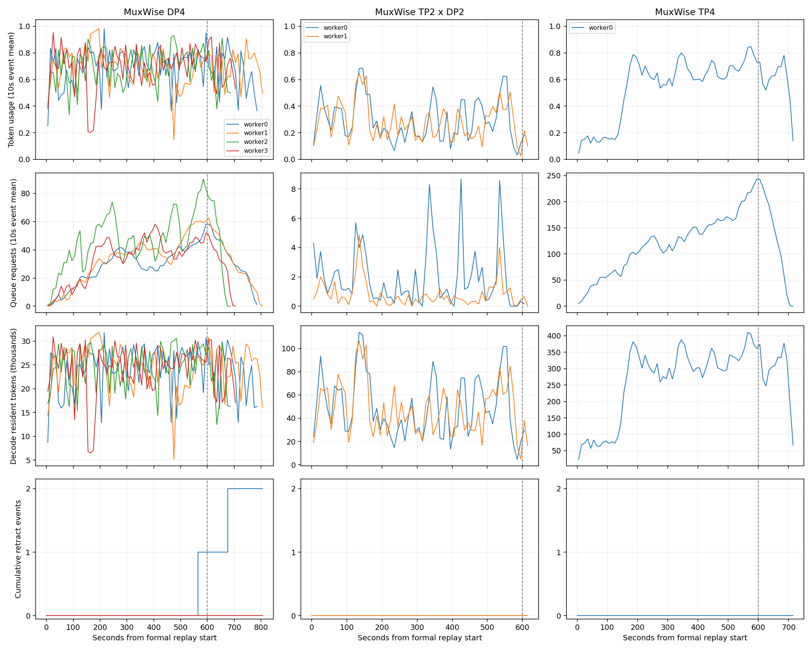
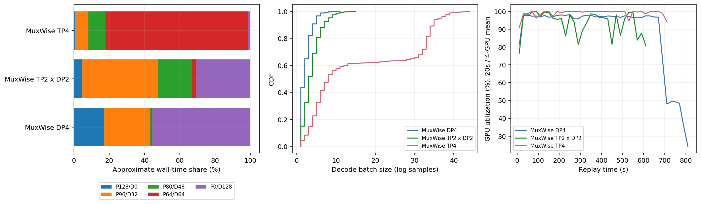
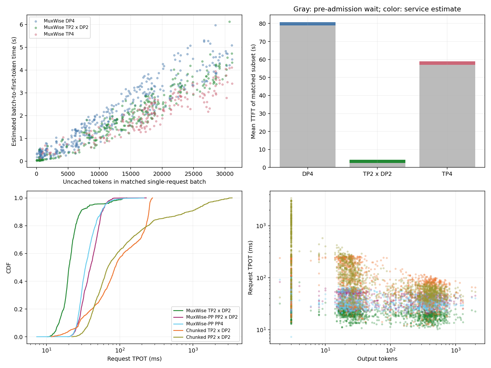
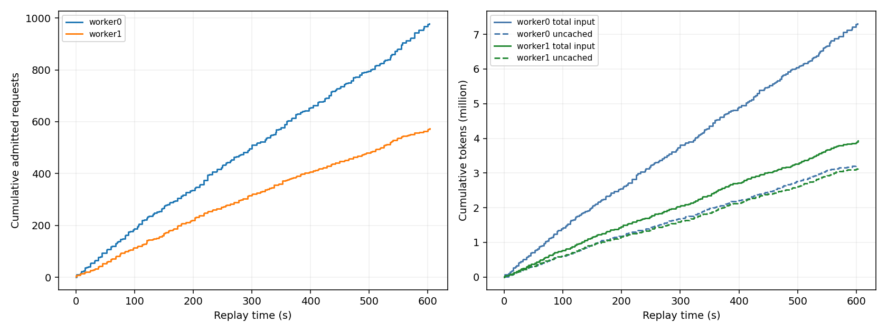

# P8b：MuxWise TP2×DP2 为什么在本次负载上最好

本分析只读取已保存的 P7b 正式结果、P6/P3 历史正式日志及配置记录；没有运行实验、调用 GPU、启动服务或修改 `sglang`。分析日期：2026-10-22。所有“最好”均指这台四卡 RTX4090、这条 1551 请求的 trace、这组已选配置中的主 SLO 最好，不代表各延迟分位全部最好。

**主要结论：TP2×DP2 同时避开了 DP4 的整请求 KV 准入压力和 TP4 的单实例扩展性问题；足够的 KV 让 prefill 与 decode 能持续共存，两个实例又分担了几乎相等的未缓存输入计算。** 单请求 prefill 的估计加速只有约 1.2 倍，无法单独解释 TTFT p50 从 62.20s 降至 1.79s；主要差异在排队。这里“主要”是多项观测支持的机制推断，没有单因素消融。

**先纠正任务中的一个数字：MuxWise TP2×DP2 的正式 TPOT p50/p99 是 20.212/104.941ms；65.896ms 是 MuxWise DP4 的 p99。** TP2 的 SSE 间隔 p99 为 28.743ms，这又是另一种统计量，不能与请求平均 TPOT 混用。[TP2 summary](results/muxwise_tp2dp2_summary.json) · [DP4 summary](results/muxwise_r2_cut300_summary.json)

| 系统/配置 | 主 SLO | TTFT p50/p99 (s) | TPOT p50/p99 (ms) | 完成时长 (s) | 加权 cache 命中率 |
| --- | ---: | ---: | ---: | ---: | ---: |
| MuxWise DP4 | 3.546% | 62.200 / 200.475 | 23.424 / 65.896 | 805.32 | 35.815% |
| **MuxWise TP2×DP2** | **82.656%** | **1.791 / 10.063** | **20.212 / 104.941** | **613.82** | **43.143%** |
| MuxWise TP4 | 2.515% | 52.556 / 115.820 | 44.871 / 186.280 | 714.87 | 43.694% |
| MuxWise-PP PP2×DP2 | 40.232% | 5.817 / 31.574 | 39.622 / 77.895 | 620.90 | 37.659% |
| MuxWise-PP PP4 | 31.915% | 6.150 / 13.365 | 33.940 / 90.305 | 621.62 | 42.880% |
| Chunked TP2×DP2 | 38.362% | 2.034 / 15.642 | 85.991 / 268.722 | 615.76 | 42.310% |
| Chunked PP2×DP2 | 58.672% | 0.783 / 7.249 | 68.767 / 2637.747 | 618.03 | 42.571% |

主 SLO 为 TTFT≤5s 且 TPOT≤100ms，分母全部 1551 条；表中七配置均全部完成，TPOT 样本均为 1543 条。总体数值来自 [matrix_summary.csv](results/matrix_summary.csv) 和各正式 summary。旧运行采用 `*_cut300_summary.json`。

## 证据口径与可测量边界

- 客户端 `run_started_unix` 为正式回放零点；服务端、`gpu.csv` 的时钟为 UTC+8，router 日志为 UTC。显式转换时区后对齐，不能直接按日志字符串比较时间。
- 占用率、队列及 decode batch 分布只取**整个日志秒都在正式窗口内**的记录；TP/PP 仅保留逻辑实例的 TP0/PP0，避免重复计数。它们是**事件采样分位，不是时间加权分位**。decode 每 40 步打印一次，快阶段会产生更多样本；TP4 的全窗口占用 p50 因此明显低于繁忙阶段的占用。
- prefill 请求/token 总量保留正式起止边界秒，以免漏掉首批请求；去除可辨认的 16-token 客户端预热和 1/2-token 健康探针。TP2、TP4、MuxWise-PP 两配置的准入请求数、输入总量、缓存总量均与客户端**逐项守恒**。DP4 有 retract 和混入业务 batch 的探针，准入计数不当作唯一请求数。
- `token usage` 和 `#token` 按原日志含义报告；不能把它们当作包含所有可驱逐前缀的物理 KV 分配量。`gpu.csv` 约每 5 秒采样；`utilization.memory` 是内存活动率，**不是已测带宽或有效带宽利用率**。
- 原版 MuxWise 没有逐请求 ID、prefill 完成时间、逐 split 时间、NCCL 时间线或 kernel overlap trace。报告用 token 签名匹配、秒级时间界限和调度状态作估计；**无法精确分离纯 prefill GPU 计算、调度等待、传输及 allreduce，也无法给出实际 kernel 并行百分比**。
- 一配置一次正式测量；DP4 的 mem=0.826、graph max-bs=1、MLP chunk=4096，TP2 的 mem=0.76、TP4 的 mem=0.80，后两者 graph max-bs=32、MLP chunk=0。容量、graph、缓存、路由、副本数与通信同时变化，不能把差值全归因于 TP。[冻结配置](P7A_NOTES.md)

可复核的完整统计为 [analysis_metrics.json](results/analysis_metrics.json)、[analysis_derived.json](results/analysis_derived.json)；每条解析事件保留原始文件的 worker、行号与相对时间：[analysis_events.csv](results/analysis_events.csv)。

## 1. KV 容量、队列与 retract：DP4 的主要限制是什么

### 每个逻辑实例的观测

下表占用、token 数来自 decode 快照；队列 p50/max 来自正式窗口 prefill+decode 快照。TP/PP 的分片容量**不能再乘 rank 数**。

| 配置/实例 | KV 容量 (token) | decode token p50 / max | usage p50 / p99 | usage≥90% 快照占比 | queue p50 / max | retract 事件/请求 |
| --- | ---: | ---: | ---: | ---: | ---: | ---: |
| DP4 w0 | 32,421 | 25,460 / 32,412 | 79% / 99% | 25.4% | 30 / 59 | 2 / 2 |
| DP4 w1 | 32,421 | 25,900 / 32,109 | 80% / 98% | 30.3% | 36 / 64 | 0 / 0 |
| DP4 w2 | 32,421 | 27,130 / 32,337 | 84% / 99% | 36.5% | 46 / 93 | 0 / 0 |
| DP4 w3 | 32,421 | 25,950 / 32,238 | 80% / 99% | 27.4% | 37 / 61 | 0 / 0 |
| TP2×DP2 w0 | 161,473 | 39,702 / 135,515 | 25% / 74.47% | 0% | 0 / 22 | 0 / 0 |
| TP2×DP2 w1 | 161,375 | 44,178 / 126,910 | 27% / 69% | 0% | 0 / 12 | 0 / 0 |
| TP4 w0 | 475,809 | 89,962 / 415,703 | 19% / 85% | 0% | 102 / 250 | 0 / 0 |

百分比分位受原日志两位小数精度限制；完整数值见 JSON。TP2 两实例最高 usage 为 84% / 79%，TP4 为 87%。



图中前两行是 10 秒桶内事件均值，第三行只用 decode 的 `#token`；各列 token 和 queue 纵轴尺度不同。虚线为约 600s 最后一批到达，之后为排空。没有快照的时段不补零；没有 retract 的曲线为零。

DP4 的 queue 中位数在 0–120s、120–300s、300–600s 的 decode 快照中分别为 **9、35、43**；TP2 对应均为 **0**；TP4 为 **45、94、158**。TP4 同三时段的 usage 中位数为 **15%、56%、70%**，说明低全窗口 p50 不能代表后半程负载。DP4 在 600s 后继续排空约 205s，TP2 约 14s，TP4 约 115s。

**容量压力并不要求 usage 始终等于 100%。** trace 最大输入为 31,663 token，已接近 DP4 的整池 32,421 token；一个尚未结束的长 decode 就可能使下一条整请求 prefill 无法准入。TP2 单实例容量是 DP4 的约 **4.98 倍**，可同时容纳若干长上下文。

进一步检查“下一次单请求 prefill”可与客户端唯一匹配、且该请求在当前 decode 快照前已经到达的排队快照：

| 配置 | 可判断快照数 | `容量−当前#token < 下一批#new-token` | 占比 |
| --- | ---: | ---: | ---: |
| DP4 | 1,851 | 1,700 | 91.8% |
| TP2×DP2 | 372 | 0 | 0% |
| TP4 | 128 | 0 | 0% |

这是**有条件样本的空间可行性诊断**，不是所有请求被 KV 阻塞的占比，也没有直接读到调度器拒绝原因。但它比只看满池或 retract 更有解释力。例如 DP4 w0 在回放约 15.89s 时 `#token=30525, #queue-req=1`，报告剩余空间仅 1,896；下一批需要 26,015 个新 token 的 idx=3547 已在 15.00s 到达。[worker0.log](logs/p6/muxwise_r2-formal-adjust1/worker0.log) 第 523、536 行。

DP4 仅有 **2 次 retract，各撤回 1 条**，发生在约 564.89s 和 675.89s；第二次在排空期。TP2、TP4 均为零。[DP4 第 1643、1834 行](logs/p6/muxwise_r2-formal-adjust1/worker0.log)。所以“大量 retract 重算拖垮 DP4”不成立；更符合日志的是**准入提前受限、排队等待 KV 释放**，而不是反复抢占。

**判断（推断，证据较强）：KV 容量/整请求准入是 DP4 的主要瓶颈之一，很可能是相对 TP2 的主因；不能证明它独自解释全部差距。** DP4 还同时受到较慢的单卡 prefill、较低缓存命中及小 graph 范围影响。缓存率从 35.815% 到 43.143%，使 TP2 总未缓存输入从约 721.8 万降至 639.4 万，减少约 11.4%；这也是收益的一部分。

## 2. prefill/decode 复用：分区、batch 与可观察重叠

### SM 分区分布与切换

原版 MuxWise 的正式日志没有 `stream_idx` 字段，但有 `Adjusting stream groups`。按 TP0 去重，并把最近一条 group 状态保持到下一次记录，得到下面的**近似状态驻留时长**。同一 group 重复打印不算真正切换；日志秒级精度会给短状态带来量化误差，group 0/4 的持有时间也可能包含空闲，不能当作 kernel 利用率。

| group / prefill SM / decode SM | DP4 驻留占比 | TP2×DP2 驻留占比 | TP4 驻留占比 |
| --- | ---: | ---: | ---: |
| 0 / 128 / 0 | 17.10% | 4.50% | 0.68% |
| 1 / 96 / 32 | 25.91% | 43.29% | 7.55% |
| 2 / 80 / 48 | 0.84% | 19.31% | 9.79% |
| 3 / 64 / 64 | 0.19% | 1.95% | 80.57% |
| 4 / 0 / 128 | 55.96% | 30.95% | 1.40% |
| 两侧均有 SM 的 group 1–3 合计 | **26.94%** | **64.55%** | **97.92%** |
| 调整日志条数 / 真正切换数（所有实例合计） | 1,383 / 1,114 | 753 / 449 | 450 / 60 |
| 各实例真正切换次数/分钟 | 17.51–25.85 | 21.21–22.68 | 5.04 |

[分区配置](configs/pdmux_4090.yml) 定义了 96/32、80/48、64/64 三档及两端独占状态。这里的百分比为实例时间加权，不是 GPU rank 日志计数。



DP4 有约 56% 时间保持 decode-only，而 96%–98% 的 decode 快照仍有排队；结合上一节的空间诊断，符合“有待处理请求却不能让 prefill 与 decode 共存”的解释。TP2 多数时间使用 96/32 或 80/48，小 decode batch 留出更多 SM 给 prefill。TP4 几乎一直双侧分区，却主要停留在 64/64；**高重叠状态占比不等于高服务效率**。

### decode batch 与 prefill 批次

| 配置 | decode 快照 n | decode batch p50 / p90 / p99 / max | prefill 日志批次数 | 每批新请求 p50 / p90 / max | 每批新 token p50 / p90 / max |
| --- | ---: | ---: | ---: | ---: | ---: |
| MuxWise DP4 | 2,894 | 2 / 4 / 7 / 11 | 703 | 1 / 4 / 21 | 9,528 / 20,066 / 31,151 |
| MuxWise TP2×DP2 | 1,715 | 3 / 7 / 11 / 15 | 567 | 1 / 7 / 20 | 11,285 / 21,982 / 31,151 |
| MuxWise TP4 | 400 | 8 / 35 / 40 / 44 | 446 | 2 / 8 / 18 | 14,479 / 23,012 / 31,151 |
| MuxWise-PP PP2×DP2 | 1,747 | 3 / 6 / 10 / 13 | 681 | 1 / 4 / 17 | 9,360 / 20,211 / 31,151 |
| MuxWise-PP PP4 | 1,897 | 3 / 6 / 10 / 12 | 536 | 2 / 7 / 16 | 12,492 / 22,386 / 31,151 |
| Chunked TP2×DP2 | 596 | 7 / 19 / 29 / 35 | 3,370 | 1 / 2 / 9 | 2,032 / 2,042 / 2,048 |
| Chunked PP2×DP2 | 1,252 | 5 / 10 / 14 / 16 | 3,371 | 1 / 2 / 10 | 2,048 / 2,048 / 2,048 |

原版 MuxWise 这里是**整批 prefill 准入**，MuxWise-PP 是 `admit batch`，Chunked 是分块调用；因此不能把三类批次数直接当作同一种 kernel 调用数。DP4 的计数包含重准入及不能单独剔除的批内探针；其他 MuxWise 配置的请求/token 守恒核验通过。

MuxWise 原版 `split_forward_token_budget=65536`，但现有日志不记录每个 split 的 token/layer 大小、起止时刻或完成耗时。上表**不能冒充 split 分布**；可得到的耗时估计是下一节单请求“批次开始到首 token”的时间。MuxWise-PP 有累计 slice 分类计数，可计算 stage0 每 slice 的日志计时均值：

| MuxWise-PP 配置/实例 | 统计窗口 (回放秒) | first slice：n / 均值 ms | middle slice：n / 均值 ms | final slice：n / 均值 ms |
| --- | ---: | ---: | ---: | ---: |
| PP2×DP2 w0 | 9.30–610.30 | 258 / 70.4 | 515 / 107.6 | 386 / 50.9 |
| PP2×DP2 w1 | 8.30–618.30 | 245 / 78.8 | 521 / 117.7 | 285 / 69.5 |
| PP4 | 6.02–616.02 | 361 / 111.2 | 180 / 179.5 | 528 / 81.4 |

以上对两份正式窗口内累计 summary 做差，排除了启动/预热累计量；**只可得均值，没有逐 slice 大小或耗时分位**。`timing.cuda.prefill` 与 `slices.prefill_*` 的累计值不能直接互换，缺少插桩语义的日志证据时，不把这些均值称为纯 GPU kernel 时间。原始 summary 保存在 [PP2×DP2 日志](logs/p7a/muxpp_pp2dp2/p7b-formal) 和 [PP4 日志](logs/p6/muxwise_pp_v3-formal/pp4.log)。

### 实际重叠能确认到哪一层

对下一节可唯一匹配的单请求 prefill，取其最晚可能开始时刻至客户端首 token 的**保守时间区间**：

| 配置 | 匹配单请求数 | 区间内有同 worker 完整秒 decode 日志 | 区间内有同 worker 其他已匹配请求的后续 SSE |
| --- | ---: | ---: | ---: |
| DP4 | 382 | 120 | 137 |
| TP2×DP2 | 301 | 178 | 205 |
| TP4 | 182 | 59 | 165 |

例如 TP2 有 205/301（68.1%）匹配请求在 prefill 服务区间内，另一个同实例请求仍交付了后续 token；这直接支持**请求服务层面两种工作交错推进**。表中短 prefill 更难包含一个完整日志秒，各列不能直接当跨配置 kernel overlap 排名。SSE 可受缓冲影响，decode 日志也不是 kernel 事件；**实际 GPU 同时执行比例仍不可识别**。尤其 TP4 同样有充分的重叠调度证据，不能把其失败简单归结为“完全没重叠”。

## 3. TTFT 分解、prefill 加速与 TPOT 长尾

### TTFT 的可审计估计

仅选择 `#new-seq=1` 的批次，要求 `(new+cached, cached)` 与客户端 `(input_len, cached_tokens)` 完全一致，且服务端日志秒与客户端 `[sent_at, first_token_at]` 相交。**客户端和服务端双向唯一**才接受，不按到达顺序强行配对；否则丢弃。匹配结果：[analysis_prefill_matches.csv](results/analysis_prefill_matches.csv)。

若日志时刻为 `t`，首 token 为 `f`，发送时刻为 `a`，则批次开始区间为：

```text
start ∈ [max(t,a), min(t+1,f)]
准入前等待 Q = start − a
批次到首 token 服务时间 S = f − start
TTFT = Q + S
```

区间中点给点估计。`Q` 含路由、tokenization、排队及准入前开销；`S` 含 prefill 计算、通信、调度停顿、采样和首 token 返回，**不是纯 prefill GPU 计算**。表中区间只反映日志秒级分辨率，不是统计置信区间。

| 配置 | 匹配 n | 匹配子集平均 TTFT | 平均 Q，估计 [时间量化下界, 上界] | 平均 S，估计 [时间量化下界, 上界] | 平均等待占 TTFT |
| --- | ---: | ---: | ---: | ---: | ---: |
| DP4 | 382 | 80.788s | 78.865 [78.407,79.323]s | 1.924 [1.466,2.382]s | 97.6% |
| TP2×DP2 | 301 | 4.365s | 2.561 [2.154,2.968]s | 1.804 [1.396,2.211]s | 58.7% |
| TP4 | 182 | 59.052s | 56.973 [56.484,57.462]s | 2.079 [1.590,2.568]s | 96.5% |

这些子集偏向单独准入的长请求，**不能外推为全体请求的平均分解**；TP2 全体平均 TTFT 为 2.568s，明显低于该子集 4.365s。这里使用均值以保持可加性，没有把两个 p50 相加冒充 TTFT p50。



### TP2 相对 TP1 的单请求 prefill 加速

进一步匹配同一 trace idx，要求两个配置中都是单请求批次且缓存量相同，避免把 cache 收益当计算加速。耗时比用同批请求的 `ΣS_before / ΣS_after`：

| 配对 | n | before/after 服务时间均值 | 估计加速比 | 仅由秒级时间不确定性形成的最宽比值界限 | 未缓存 token / 服务秒（每实例） |
| --- | ---: | ---: | ---: | ---: | ---: |
| TP1(DP4) → TP2 | 187 | 2.976 / 2.464s | **1.208×** | 0.841–1.754× | 6,184 → 7,470 tok/s |
| TP2 → TP4 | 149 | 2.716 / 2.324s | **1.168×** | 0.789–1.754× | 7,446 → 8,700 tok/s |

相同未缓存长度分桶，TP1→TP2 的估计加速为：8k–16k（n=54）1.247×，16k–24k（n=81）1.241×，24k–40k（n=42）1.142×。[逐对明细](results/analysis_prefill_pairs.csv)

**解释：约 1.2× 是运行负载下的服务时间估计，不能声称测得 2× 纯计算加速；保守时间界限甚至包含 1。** SM 分区、并行 decode、graph 与 MLP chunk 配置仍不同。DP4 与 TP2 的总体 TTFT p50 比值约 34.7×，显然主要不是由这个单请求服务时间差构成。TP4 即使单请求略快，也不足以弥补从两个 TP2 实例变成一个 TP4 实例。

### 为什么 Chunked PP2×DP2 的 TPOT p99 达到 2.6s

TPOT 是一条请求的平均间隔 `(E2E−TTFT)/(output_tokens−1)`；ITL 是记录到的 SSE 间隔，两者样本权重不同。所有配置的输出长度分布相同：2–8 token 362 条，9–64 token 560 条，≥65 token 621 条；另有 8 条单 token。

| 配置 | 请求 TPOT p50 / p99 | SSE ITL p50 / p99 / max | ITL>1s 个数 | 2–8 token 请求 TPOT p99 | ≥65 token 请求 TPOT p99 |
| --- | ---: | ---: | ---: | ---: | ---: |
| MuxWise TP2×DP2 | 20.2 / 104.9ms | 18.6 / 28.7 / 428.6ms | **0** | 110.9ms | 26.9ms |
| MuxWise TP4 | 44.9 / 186.3ms | 30.9 / 977.5 / 2691.7ms | 2,520 | 183.3ms | 165.4ms |
| MuxWise-PP PP2×DP2 | 39.6 / 77.9ms | 30.1 / 66.0 / 288.6ms | 0 | 82.9ms | 52.8ms |
| MuxWise-PP PP4 | 33.9 / 90.3ms | 29.1 / 98.3 / 418.9ms | 0 | 154.2ms | 51.4ms |
| Chunked TP2×DP2 | 86.0 / 268.7ms | 24.7 / 293.3 / 336.8ms | 0 | 276.3ms | 138.3ms |
| Chunked PP2×DP2 | 68.8 / 2637.7ms | 31.5 / 735.2 / 7251.6ms | **2,336** | **3083.7ms** | **91.3ms** |

Chunked PP2×DP2 的 583 条 TPOT>100ms 请求中，288 条为 2–8 token、291 条为 9–64 token，只有 4 条为≥65 token。**短请求不能摊薄 prefill 造成的 decode 停顿。** 具体 idx=4615：输出 3 token，TTFT=0.493s，第一到第二 token 相隔 **6.800s**，第二到第三只约 **39ms**，因此 TPOT=3.420s。末 token 到请求结束只有约 0.022ms，排除了“仅是 HTTP 收尾慢”的解释。[请求明细](results/chunked_pp2dp2_requests.jsonl)

该请求停顿对应本地时钟 16:26:10.647–16:26:17.447，两实例均在密集处理 2048-token prefill chunks；例如 [worker0.log](logs/p7a/chunked_pp2dp2/p7b-formal/worker0.log) 第 4317–4446 行、[worker1.log](logs/p7a/chunked_pp2dp2/p7b-formal/worker1.log) 第 4076–4151 行。router 未提供这条请求的 worker ID，因此不能把某个 chunk 认定为该请求停顿的唯一原因。

**机制推断：**冻结配置下 Chunked PP 禁用了 mixed chunk，连续 prefill 与 PP 调度/流水线等待可使已经拿到首 token 的短请求等数秒才进入后续 decode；这解释其 TTFT 很好但联合 SLO 被 TPOT 拖低。MuxWise 使用独立分区推进 decode，代价是 prefill 请求可能先排队，收益是减少首 token 后的大停顿。

TP2 自身并非完全无长间隔：21 条 TPOT>100ms 全是 2–8 token 请求。最差 idx=4814 的两个间隔约 **226.7ms、23.1ms**，TPOT=124.928ms。少量短请求足以把请求 p99 推过 100ms，但对 260,225 个 ITL 样本的 p99 影响较小。主 SLO 未达标的主要来源仍是 TTFT：242 条 TTFT>5s，21 条 TPOT>100ms（两者重合 1 条），另有 8 条单 token/TPOT 未定义，其中 7 条未被 TTFT>5s 覆盖；因此总未达标为242+21−1+7=269，联合达标数为1282/1551。

DP4 虽然请求 TPOT p99 为65.90ms，但其最大 SSE 间隔达190.740s，且有2个间隔超过1s；所以不能凭较低的请求p99就判断它比TP2全面稳定。少量极端事件与大量平稳decode可以同时存在。

## 4. TP 通信代价：TP4 为什么掉到 2.5% SLO

**直接证据：**P7a 核验所有卡对 CUDA P2P=false，TP2/TP4 显式禁用 custom allreduce；正式启动日志有 `via SHM/direct/direct`。TP2 组为 GPU1+2 和 GPU0+3，TP4 顺序为 1,2,0,3，包含跨 NUMA 路径。[拓扑](logs/p7a/topology.txt) · [P2P 核验](logs/p7a/cuda-device-map.json) · [TP2 NCCL 日志第 63–64 行](logs/p7a/muxwise_tp2dp2/p7b-formal/worker0.log) · [TP4 第 79–80、118 行](logs/p7a/muxwise_tp4/p7b-formal/worker0.log)

| 指标 | TP2×DP2 | TP4 | 支持的解释 |
| --- | ---: | ---: | --- |
| 逻辑服务实例 | 2 | 1 | TP4 丧失独立排队/计算副本 |
| GPU utilization 平均（4卡、全正式窗） | 93.60% | 99.08% | TP4 不是长时间没有 GPU 活动 |
| memory utilization 平均 | 80.03% | 35.21% | 活动形态不同，不能直接换算带宽效率 |
| decode batch p90 / max | 7 / 15 | 35 / 44 | TP4 更大且长时间保持 64/64 分区 |
| decode 快照 cuda graph=True | 100% / 100% | 71.8% | TP4 存在超 graph max-bs=32 的路径 |
| 客户端 ITL p50 / p99 | 18.63 / 28.74ms | 30.88 / 977.53ms | 有负载时 decode 明显更不稳定 |
| `1000×running/tps` 日志步时代理 p50 / p99 | 16.58 / 68.71ms | 16.40 / 195.02ms | TP4 中位值混入快阶段，尾部明显变慢 |
| 同工作量单请求 prefill 服务吞吐 | 7,446 tok/s/实例 | 8,700 tok/s/实例 | 多一倍 rank 仅约 1.17× 的估计收益 |
| 全正式窗口未缓存输入交付率² | 10,417 tok/s（两实例） | 8,857 tok/s（一实例） | TP4 有积压，排空更久 |

² 输入减成功响应 cached token 再除全运行时长，是交付工作量/时间；不等于剥离空闲后的 GPU prefill 峰值。正式到达期约 600s，TP4 的未缓存输入需求约 **10,553 tok/s**，高于其含排空的交付率。

日志步时代理不是逐步计时：`tps` 统计区间里 batch 可能变化，且包含 prefill/调度时间。为检查这一偏差，另选相邻 decode 日志 batch 相同、`#token` 正好增加 `40×batch`、中间没有新 prefill/retract 的区间。TP2 两实例代理 p50 为 **13.72/13.55ms**（355/377 样本），TP4 为 **13.35ms**（仅 70 样本）。因此**不能声称 TP4 每个纯 decode 步都比 TP2 慢**；退化集中在高并发、prefill 干扰和调度繁忙阶段。TP4 的 batch≥17 快照代理 p50/p99 为 **86.87/205.90ms**，其 batch≤8 时明显更低；这也包含更大 batch 与状态选择效应。

**最符合数据的机制链（推断）：**四 rank 的层内通信使用 SHM/host 路径，新增 rank 的通信与同步成本抵消大部分分片计算收益；少一个 DP 副本后，单实例总 prefill 服务能力不足，排队增大；驻留 decode batch 增长又把分区推到 64/64，部分 batch 失去 graph，进一步加重相互干扰。TP2 以较小通信组取得足够的容量和可接受的服务速率，同时仍保留两个实例，队列没有持续累积。

**不能由现有日志证明：**allreduce 占总时间的百分比、哪个 NUMA 路径贡献多少、TP4 的全部差值是否来自 NCCL。GPU 100% 同时可能包含计算、通信 kernel 或等待；高 GPU 活动且内存活动较低只与通信/同步开销解释相容，并不是专有诊断。尤其 TP4 cache 为 43.694%，略高于 TP2，且无 retract、usage最高87%；它的 SLO“崩塌”是性能失速，**不是进程崩溃，也不是 KV 用满**。1551 条最终均完成。

## 5. cache_aware 的负载均衡：请求不均，未缓存计算很均

由 TP0 的整批准入求和，剔除 8 个独立 1-token 探针，得到精确分配：

| TP2×DP2 实例 | 请求数 / 占比 | 输入 token / 占比 | 新计算 token / 占比 | cached token | 实例加权命中率 |
| --- | ---: | ---: | ---: | ---: | ---: |
| worker0，GPU1+2 | 978 / 63.06% | 7,306,461 / 64.97% | 3,230,410 / 50.52% | 4,076,051 | 55.79% |
| worker1，GPU0+3 | 573 / 36.94% | 3,939,176 / 35.03% | 3,163,483 / 49.48% | 775,693 | 19.69% |
| 合计 | **1,551** | **11,245,637** | **6,393,893** | **4,851,744** | **43.143%** |



总输入、缓存和请求数分别精确等于客户端汇总；原始日志为 [worker0](logs/p7a/muxwise_tp2dp2/p7b-formal/worker0.log)、[worker1](logs/p7a/muxwise_tp2dp2/p7b-formal/worker1.log)。缓存共享较多的请求集中在 w0，使其承接更多请求和原始输入，但两实例未缓存工作量仅相差 **2.12%（大值/小值−1）**。四卡平均 GPU utilization 逐卡为 93.93%、93.53%、93.33%、93.63%，也没有某组明显闲置的迹象。

**推断：cache_aware 在此负载下实现了有效的未缓存计算分摊，同时保留前缀亲和；不能用 63/37 的请求数单独判断负载失衡。** w0 的 queue max=22 高于 w1 的 12，局部突发仍不均衡。未缓存token数也只是计算工作量代理：上下文长度影响attention成本，且输出token分配未完全恢复，不能断言两个实例的实际FLOP或总服务成本精确相等。

router 的 INFO 日志只记录请求开始/响应头及前缀树 eviction 信息，没有逐请求 worker 选择或 KV 命中。其最终 `Tenant Size` 为 16,242,065 / 16,224,725，是 router 树的大小计量，**不解释为 GPU KV token 数或真实 cache hit**。约毫秒级的 router `finished processing request` 也不是流式响应结束时间。[router-formal.log](logs/p7a/muxwise_tp2dp2/p7b-formal/router-formal.log)

缓存率采用客户端 `cached_tokens` 和服务端批次 cached 的守恒结果；请求/token 分配表是**输入 token 分配**。现有记录不能精确恢复每个 worker 的全部输出 token 分配，也不能识别每条请求选择该 worker 的具体理由。

## 6. MuxWise-PP 与 Chunked 的瓶颈对照

MuxWise-PP 的 summary 提供了更直接的准入原因计时。仍只对正式窗口内两份累计 summary 做差，表中的时间是调度器所记原因的 wall 时间，不是逐请求排队时长，也不能跨 stage 相加当端到端时长。

| 配置/实例 stage0 | 有效计时窗口 | inflight 上限阻塞 | KV 阻塞 | decode reserve 阻塞 | 三者解释 |
| --- | ---: | ---: | ---: | ---: | --- |
| PP2×DP2 w0 | 600.64s | 167.66s / 27.91% | 136.45s / 22.72% | 103.71s / 17.27% | 仅 3 个 prefill inflight，容量/预留也显著约束准入 |
| PP2×DP2 w1 | 610.59s | 120.06s / 19.66% | 166.57s / 27.28% | 51.94s / 8.51% | 同样存在容量与 inflight 压力 |
| PP4 | 610.37s | 188.23s / 30.84% | 2.71s / 0.44% | 21.98s / 3.60% | 主要不是 KV 容量，而是流水线/inflight 节奏 |

PP2×DP2 的每实例 KV 仅 126,501/126,411，decode usage p50 81%/80%，约 33% decode 快照 usage≥90%；远比 MuxWise TP2 的 25%/27% 紧张。PP4 的 KV 为 359,498；容量压力较小，但 stage0 的 prefill `send` 累计 44.62s、stage3 的 `upstream` 218.43s，显示跨 stage 的流动与等待是不可忽略的路径。两者是不同 stage/侧的累计时间，不能相加；也不能将 `send` 全认定为纯网络传输。

PP2 两实例的 stage0 `timing.cuda.prefill/decode` 分别为 310.93/481.19s 与 317.29/485.78s，各自和超过窗口 600.64/610.59s；PP4 stage0 为 344.95/483.68s，窗口610.37s。这与两侧计时区间重叠相符，**但这些累计计时包括何种等待无法仅从日志断定，因此不换算为实际 kernel overlap 比例**。

| 系统/配置 | 本负载上的瓶颈，一句话概括 |
| --- | --- |
| MuxWise DP4 | 32k 级 KV 难以同时容纳长 decode 与下一条整请求 prefill，准入等待主导 TTFT，retract 只是少量症状。 |
| MuxWise TP2×DP2 | 容量与副本数达到较好平衡，剩余损失主要是突发/长 prefill 的准入等待，而非持续 decode 停顿。 |
| MuxWise TP4 | 单实例四 rank 的服务扩展性不足，通信/同步、较大 decode batch 和分区/graph 路径共同放大排队，KV 并非主限。 |
| MuxWise-PP PP2×DP2 | 126k KV、decode reserve 和每实例 3 个 prefill inflight 限制准入，PP stage 等待又提高端到端延迟。 |
| MuxWise-PP PP4 | KV 已较充足，四 stage 的串行路径、流水线等待与 inflight 上限限制 TTFT；decode 比 Chunked 平稳但不及 TP2 的中位数。 |
| Chunked TP2×DP2 | 约 2048-token prefill 块与 decode 交替/混合执行，持续 prefill 干扰使 TPOT p50 达86ms、665条请求超过100ms。 |
| Chunked PP2×DP2 | 较快交付首 token，但连续分块 prefill 与 PP 等待使短输出请求的后续 decode 饥饿，形成秒级 TPOT 尾部。 |

除显式的计时/计数外，“瓶颈”列均是多项观测支持的机制推断。Chunked PP4/TP2PP2 在正式运行发生调度崩溃，不能用其尾延迟做稳定机制比较，本报告不以它们预测 P8a 的性能。

## 7. 对 P8a（MuxWise-PP PP2×TP2）的可检验预测

这里假设 P8a 使用同样四张卡，**PP2×TP2 是一个逻辑实例（DP1）**，每个 stage 内 TP2；同样模型、负载、SLO和统计口径，功能正确且无失败。以下是实验前预测，**不是已经测到的结果，也不要求 P8a 现在增跑实验或修改参数**。

| 指标 | 相对现有 MuxWise-PP 的预测 | 相对 MuxWise TP2×DP2 的预测与可证伪点 |
| --- | --- | --- |
| 单实例 KV 与准入压力 | 模型权重和 KV 同时沿 PP/TP 分片，单逻辑实例容量有望高于现 PP2 的126k；`kv`、`decode_reserve` 阻塞占比应低于现有22.7%–27.3%、8.5%–17.3% | 有机会超过 TP2 单实例161k；实际大小取决于 mem、graph与临时 buffer，不能直接把容量乘rank，也不保证超过两个TP2实例的合计322.8k |
| 单请求长 prefill 服务时间 | 每 stage 内 TP 有望缩短计算段；比 TP1 的PP2更快，TTFT p99 有望低于31.57s | 可能接近TP2的服务时间；仍需经过两个stage与边界传输，不能预言快于TP2；用相同idx、相同cache的匹配服务时间验证 |
| 整体 TTFT / 主 SLO | 若容量阻塞下降且pipeline保持工作，预计 TTFT p50<5.817s、p99<31.574s，主SLO>40.232% | **不预言达到1.791s/82.656%**：单实例失去两个独立准入队列和副本，inflight/ready/upstream可能成为新主限；若排队仍增长，此乐观预测被否证 |
| decode 中位数与长输出 | stage内加速有望使TPOT p50低于PP2的39.62ms，并减少长请求decode时间 | **不预言低于20.21ms**：token仍串行经过两stage；层内TP2通信与stage边界通信均存在，流水线吞吐不等于单token延迟 |
| TPOT 尾部/稳定性 | 保留SM分区与decode预留，应继续没有Chunked PP2那样普遍的秒级停顿 | **最有希望接近或超过的指标是请求TPOT p99**：现PP2已为77.9ms，低于TP2的104.9ms；同时检查ITL p99和输出长度分桶，避免因短输出权重得到误导性的胜出；若出现大量ITL>1s，则空间复用保护失效或新增同步开销暴露 |
| TP通信扩展性 | 每stage仅两rank的collective，可避免TP4的四rank同步模式，但增加PP边界流量 | 预计比原MuxWise TP4更稳健；**不保证达到两个TP2实例的总服务率**。每token仍要完成全模型各层的TP通信，不能把“两stage”解释为通信次数减半 |
| cache与负载分配 | 单实例可共享所有前缀，消除两个router副本间的分流偏斜 | cache率可能略改善，但不预测明显超过43.14%：现TP4也只有43.69%，PP4为42.88%；cache本身不足以弥补失去DP并发 |
| 总输出吞吐 | 全部按时完成时应接近现有约422–426 tok/s | **不预言显著超过426.47 tok/s**：固定261,776输出、最后到达约600s，整体已受开放环到达和最后请求排空限制；即使极端地600s结束，上界也仅约436.3 tok/s，约2.3%空间 |

优先检验的机制是：**容量约束是否转移成 inflight/流水线约束，以及 TP2 stage 的局部加速能否抵消少一个 DP 副本。** 若 P8a 取得更大 KV、较少 KV 阻塞，但 TTFT 仍不改善，就应把原因指向单实例服务节奏和 stage 等待；若 TTFT 改善却 ITL 尾部恶化，则表明新增通信/同步破坏了 decode 的持续推进。上述判断都可用 P8a 已计划实验中的 summary、准入原因和时序日志检验。

## 原始材料、复现与审计

| 配置 | 正式日志目录 | 结果来源 |
| --- | --- | --- |
| MuxWise DP4 | [logs/p6/muxwise_r2-formal-adjust1](logs/p6/muxwise_r2-formal-adjust1) | `muxwise_r2_requests.jsonl`、`muxwise_r2_cut300_summary.json` |
| MuxWise TP2×DP2 | [logs/p7a/muxwise_tp2dp2/p7b-formal](logs/p7a/muxwise_tp2dp2/p7b-formal) | `muxwise_tp2dp2_*` |
| MuxWise TP4 | [logs/p7a/muxwise_tp4/p7b-formal](logs/p7a/muxwise_tp4/p7b-formal) | `muxwise_tp4_*` |
| MuxWise-PP PP2×DP2 | [logs/p7a/muxpp_pp2dp2/p7b-formal](logs/p7a/muxpp_pp2dp2/p7b-formal) | `muxpp_pp2dp2_*` |
| MuxWise-PP PP4 | [logs/p6/muxwise_pp_v3-formal](logs/p6/muxwise_pp_v3-formal) | `muxwise_pp_v3_requests.jsonl`、`muxwise_pp_v3_cut300_summary.json` |
| Chunked TP2×DP2 / PP2×DP2 | [TP2](logs/p7a/chunked_tp2dp2/p7b-formal)、[PP2](logs/p7a/chunked_pp2dp2/p7b-formal) | `chunked_tp2dp2_*`、`chunked_pp2dp2_*` |

附加读取 Chunked DP4/TP4 作交叉检查；未把预检、smoke 或开发trace纳入性能结论。结果文件均位于 `results/`。

CPU 复现命令（仅重建本分析的 JSON/CSV/PNG，不生成请求，不启动服务）：

```bash
cd /root/workspace/muxpp_work
OPENBLAS_NUM_THREADS=1 OMP_NUM_THREADS=1 python scripts/p8b_analyze.py
```

[分析脚本](scripts/p8b_analyze.py) 只依赖 Python 标准库、NumPy 和 Matplotlib。64 个程序读取输入的 SHA256 及读取后不变检查见 [analysis_input_sha256.json](results/analysis_input_sha256.json)；目标 TP2、TP4、MuxWise-PP 两配置的请求/输入/cache 总量守恒检查通过。图为标准 Matplotlib PNG，英文坐标用于避免环境缺失中文字体；本文给出中文说明。`RESULTS.md` 原有字节仅作前缀校验，更新仅追加链接小节。
