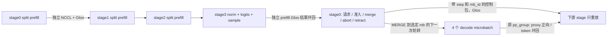

# P1 MuxWise-PP 实现与验证

状态：**P1 完成**。正确性、200 条 trace 压测、原 pdmux/PP 回归和补充控制测试均通过。代码分支 `muxwise-pp`，仅本地提交，不 push。

## 架构与时序



每个 stage 的主线程维护所有 Req、KV allocator、radix cache。prefill 通道有两个 CPU 元数据线程和一个 NCCL 发射线程；计算仍由调度主线程按层切片发射。每条 NCCL 操作使用任务携带的**当前所选 prefill stream**，用 `threading.Event` 确认发射结束后才能查询 CUDA 完成 event。收到 hidden 的元数据前不发射 recv；收到后即使 NCCL 建连在主机端等待，也不会阻塞 decode 调度。发射未完成或 CUDA event 未完成时禁止切分区；其余切换先同步本地两个 stream。

Decode 使用上游 `event_loop_pp` 的微批环：运行 mb_i → 收取/处理 mb_(i+1) 的旧 token → 转发旧 token → 转发控制包 → 转发当前 proxy。原 pp_group 专用于 decode hidden/token；控制包走 world 的 Gloo 组，避免与 pp_group 的 tensor-dict 元数据混流。所有 decode CUDA API 在 decode stream 上调用。

Prefill 在整条 PP 中同时最多一批：ADMIT → 各 stage 建同一请求集并分配本地 KV → stage0 embed / 本地层 → 逐级异步传 hidden+residual → 末级 sample → stage0 决定 merge 的 mb → 控制包在那个 mb 的下一轮执行 merge。merge 时统一处理第一个 token 和 radix 插入，不能在各 stage 的本地计算完成时提前插入。

## 关键代码与接口

- `python/sglang/srt/multiplex/multiplexing_pp.py`：`SchedulerMultiplexPPMixin.event_loop_pdmux_pp`、`PrefillMailbox`、准入/重放/合入/abort/retract，P2 policy hooks。
- `distributed/parallel_state.py`：独立 `get_pdmux_prefill_pp_group()`（NCCL、Gloo、pynccl current stream），初始化及销毁。
- `models/llama.py::forward_split_prefill`：限定 `[start_layer,end_layer)`；仅首级 embed，仅末级 norm/logits；中间级返回 `PPProxyTensors`。
- `model_executor/model_runner.py`、`managers/tp_worker.py`：本地层边界、proxy 输入、仅末级采样；PP=1 保留其他模型的调用签名。
- `managers/scheduler.py`：组合模式入口、split-prefill proxy 分支、防止 prefill 在途时 flush。
- `server_args.py`：移除 PP 与 pdmux 的互斥，显式约束 P1 支持范围。
- `test/srt/test_multiplexing_pp.py`：CPU 不变量验证。
- `/root/workspace/muxpp_work/configs/pdmux_pp_4090.yml`：5 分区（128/0、96/32、80/48、64/64、0/128），阈值 1/8/16，slice budget=8192（P0 为 65536）。PP4 每 stage 8 层，8000 token prefill 每片 1 层。
- `/root/workspace/muxpp_work/scripts/p1_verify.py`：服务生命周期管理、正确性与压测，finally 终止本次进程树并记录 nvidia-smi。

控制消息：

```text
PPControl(step, mb_id, requests,
          plan=PrefillPlan(batch_id, probes=[(rid, fill_len, prefix_len)], rids),
          merge={batch_id, target_mb, next_token_ids},
          retract=[rid], abort=[rid], migrations=[...])
prefill hidden envelope={kind: hidden, batch_id, plan,
                         tensors: [(name, shape, dtype)]}
prefill result envelope={kind: result, batch_id, tokens}
```

stage0 是唯一准入、目标 mb、abort/retract 决策者。下游校验 step/mb/batch_id、重放 probes、检查命中长度等于 plan，然后分配。未准入请求的 prefix probe 也要重放，因为匹配可能切分 radix 节点。

P2 接口为 `StaticMuxPPPolicy.partition/admission_budget/merge_target/slice_layers`。默认 merge 选未完成请求数最少的 mb，同数时选编号最小者。migration 字段和控制类型已预留，P1 不产生 migration；收到非空 migration 显式报未实现。

## 设计取舍

1. **保留 radix cache**。插入/释放在相同控制步统一执行，匹配顺序和命中长度由 stage0 下发。驱逐策略改为按 radix 节点创建次序的确定性 FIFO；避免不同 stage 的墙钟 LRU 时序产生不同 victim。节点 ID 可有常量偏移，创建相对顺序一致即可。仅组合模式替换策略，PP=1/普通 PP 不受影响。后续可在 plan 中直接指定 LRU victim，恢复原 LRU 性能语义。
2. 一批 prefill 全流水线在途，暂不实现每级各有一批/接收队列。保留 P/D 重叠和原 decode 微批流水线，但 prefill 的跨 stage 吞吐仍有优化空间。
3. 准入为**所有** decode mb 预留完整剩余输出 token，并加流水线安全余量。比上游按比例估算保守，先保障一致性；P2 可调整预算策略。上游 `ModelRunner.init_memory_pool` 已在创建池前用 world CPU group `MIN` 统一容量，不重复实现。
4. 首次试运行首轮预热停滞；改用独立 NCCL 发射线程并分离控制消息通信组后，预热及并发通过。`ncclGroupEnd` 也必须视为可能阻塞主机的操作。诊断工具 py-spy 因容器 ptrace 权限无法附加；未尝试绕过权限，改用本地日志诊断。
5. P1 支持 Llama、TP1、多 PP、普通 text/token 生成。显式拒绝不支持的 DP attention、speculative decoding、分层/外部缓存、优先级准入；logprobs、hidden 输出、session、约束解码等请求在分配前返回错误。这些不属于本次验收负载。
6. 当前环境无 rg，搜索改用 grep/find。仓库无 Git identity，按仓库级配置 `Codex <codex@localhost>` 用于本地提交，未改全局配置。

## 验证记录

日志根目录：`logs/p1/`。保留了调试失败和最终通过的全部记录。P1 是开发验证，重试有明确失败原因；未开展或重跑 DESIGN §4 的 P3 正式对比实验。

- PP4 smoke：基础请求 + 6 路并发全部成功；四级最终 free_kv=420322、evictable=7615、free_reqs=128；cached_tokens=6367 一致。见 `muxpp-smoke-04-{client,server}.log` 与 result JSON。该轮容量 427937，5 套分区，8 层/stage。
- CPU tests：**6 passed**。覆盖 PP 层边界/hidden/residual、异步通信不阻塞、分区/合入 hooks、确定性 radix 驱逐、跨微批/在途/排队请求取消的终止输出；见 `unit-tests.log`。Black/isort、compileall、git diff --check 均通过。
- TP1 correctness：20/20 完成，100–8000 输入 token，temperature=0、ignore_eos、64 输出 token；结果 `normal-correctness-result.json`。
- PP4 correctness：20/20 与 TP1 完全一致，共 1280/1280 输出 token 一致，首分叉位置均为 null。四个共享前缀族；输入长度依次为 100、128、256、512、768、1000、1500、2000、2500、3000、3500、4000、4500、5000、5500、6000、6500、7000、7500、8000。见 `correctness-comparison.json`。最后一条 TP1 命中 3986、PP4 命中 5986（容量不同造成缓存驻留不同），输出仍完全一致。
- 首次 200 trace（`muxpp-stress`）失败：0.8 静态内存比例下，stage0 在 16593 uncached token 的 prefill MLP 激活分配 OOM，1 成功/199 失败；不是死锁。所有进程已清理。后续 4090 推荐参数改为 `--mem-fraction-static 0.65`，保留更大激活空间；KV 容量降至各级 315311。保留原日志和失败 JSON，不将这轮算作通过。
- 修正配置后的 200 trace（`muxpp-stress-02`）：**200 成功 / 0 失败 / 0 未发送**，1,498,456 输入 tokens、30,659 输出 tokens，177.829 秒完成，最大输入 30,771、最大输出 794。使用现成 P3a 工具，`--limit 200 --time-scale 0.02 --warmup 2`；200 条在 1.35 秒内到达，这是压力验证，不是 P3 正式性能实验。
- 同轮 trace cache 命中 631,316 tokens（按输入 token 加权 **42.1311%**）。含预热/启动请求，四级共 66 个准入批次、867,164 uncached tokens、631,332 cached tokens，逐 batch 的请求数/新 token 数/命中数日志完全一致。累计 uncached tokens 超过 KV 容量两倍，覆盖了实际 radix 驱逐路径。
- 同轮四级最终全部 `idle self-check PASS`：`free_kv=14854 + evictable=300457 = 315311`，`free_reqs=128`，prefill_slices=461、decode_steps=14640；无 protected KV 遗留、无请求槽泄漏、无 scheduler exception。GPU 清理快照无 compute process。见 `muxpp-stress-02-{server,client}.log`、`muxpp-stress-02-result.json`、`muxpp-stress-02_summary.json`、`muxpp-stress-02_requests.jsonl`。
- 原 pdmux（PP1）：基础 + 6 并发成功，见 `pdmux-regression-*`。
- 原 PP2（无 pdmux）：基础 + 6 并发成功，见 `pp2-regression-*`。原 pdmux 服务 ready 25.056s，原 PP2 ready 21.053s；两轮结束 GPU compute process 均为空。
- 补充取消测试（`muxpp-control-02`）：16 条请求，覆盖四个 decode mb、27k-token 在途 prefill、等待队列；全部返回 abort。取消后新请求可正常生成 16 tokens，logprob 不支持请求返回 HTTP 400，flush HTTP 200，四级均打印 Cache flushed successfully。最终 idle 自检各级 `free_kv=288214 + evictable=27097 = 315311`、`free_reqs=128`；退出日志 `remaining number of requests 0`。四级记录到同轮 prefill/decode 发射次数 4/1/3/1，证明双 lane 进行了并发发射。
- 首轮取消测试（`muxpp-control`）虽 HTTP/池检查成功，但退出时发现 tokenizer 中还留有 11 条等待队列请求状态。原因是复用上游裸 `AbortReq` 输出仅唤醒等待者、未走正常终止 batch 的删除路径。组合模式改为为队列取消发送终止 batch 输出；`muxpp-control-02` 验证状态归零，未改原 pdmux/PP 路径。
- 最终清理：`nvidia-smi-final.txt` 无 GPU compute process；`processes-final.txt` 无 SGLang/p1_verify 进程，30000 端口已释放。

## 已知限制与后续

- FIFO 缓存策略与串行的 prefill admission 需要 P2/P3 实测性能，不能用基础功能测试宣称吞吐改进。
- P1 不包含 ALP/RLS、动态请求迁移、pending 暂停；仅有 policy 和控制协议接口。retract 的 stage0 命令/下游重放已实现；本轮完整输出预留使自然 retraction 未触发，不能称已通过强制 retract 故障注入测试。
- 未实现跨 stage 故障恢复。通信线程异常会回报主线程；现有 watchdog 主要覆盖 decode 活跃时段，纯 prefill 外部故障仍可能等待分布式通信超时。

## PP4 压测的可复现参数与资源

```bash
source /root/workspace/muxpp_work/env.sh
CUDA_VISIBLE_DEVICES=0,1,2,3 python -m sglang.launch_server \
  --model-path /root/autodl-pub-RTX4090-hdd-1/models/llama3.1-8B-Instruct \
  --tp 1 --pp-size 4 --port 30000 --disable-overlap-schedule \
  --enable-pdmux --chunked-prefill-size -1 \
  --pdmux-config-path /root/workspace/muxpp_work/configs/pdmux_pp_4090.yml \
  --context-length 33792 --mem-fraction-static 0.65 \
  --cuda-graph-max-bs 32 --max-running-requests 128 \
  --watchdog-timeout 180 --log-level debug
```

上述为通过的压测启动参数，模型 dtype 为自动解析的 bf16，attention backend 为 FlashInfer。每 stage 8 层、KV 容量 315311、5 套分区图；每套捕获 bs={1,2,4,8,16,24,32}，**每 stage 共 35 张 CUDA graph**。5 个分区均成功捕获；本次压力运行实际选择了 0、1、2、4，阈值 16 对应的分区 3 未在该 trace 触发。

| stage | 层区间 | max_total_num_tokens | ready 显存 MiB | 结束后显存 MiB | 采样窗口内最大 MiB |
|---|---|---:|---:|---:|---:|
| 0 | [0,8) | 315311 | 18342 | 22690 | 23910 |
| 1 | [8,16) | 315311 | 17334 | 22390 | 23564 |
| 2 | [16,24) | 315311 | 17338 | 23318 | 23630 |
| 3 | [24,32) | 315311 | 17346 | 23326 | 23640 |

显存来自 nvidia-smi，包含 PyTorch 缓存的激活内存；请求结束后预分配 KV 池和 caching allocator 的显存驻留不代表泄漏。最大值来自运行中途启动的 1 秒采样窗口，**不是严格的整轮峰值**；数据见 `muxpp-stress-02-gpu-samples.csv`。显存验证覆盖本轮最大 30771-token prompt；更大上下文或更多图需要重新设置激活空间。

## 本地提交与环境附注

- `f62f4bd01`：本 stage split-prefill 与独立 prefill PP communicator。
- `05d5c4bf4`：双 lane 调度、stage0 控制、确定性 radix 重放。
- `4018ec469`：边界检查、P2 类型接口、CPU 不变量测试。
- `88d3eab9e`：最终提交，取消状态清理与 graph 状态传递。完整日志见 `logs/p1/git-log-final.txt`。

验收汇总：[acceptance-summary.json](logs/p1/acceptance-summary.json)。

所有提交在 `muxwise-pp` 分支，无 push；最终工作树状态见 `git-status-final.txt`。为诊断/格式检查仅在 `/root/venvs/sgl` 增加 py-spy、black 24.10.0、isort 5.13.2；未更换 Torch/CUDA/FlashInfer 或重编内核。安装日志位于本目录 logs/p1。

复现入口：

```bash
source /root/workspace/muxpp_work/env.sh
python /root/workspace/muxpp_work/scripts/p1_verify.py normal --suite correctness
python /root/workspace/muxpp_work/scripts/p1_verify.py muxpp --suite correctness
python /root/workspace/muxpp_work/scripts/p1_verify.py muxpp --suite stress --tag NEW_UNIQUE_TAG
python /root/workspace/muxpp_work/scripts/p1_verify.py pdmux
python /root/workspace/muxpp_work/scripts/p1_verify.py pp
python /root/workspace/muxpp_work/scripts/p1_verify.py muxpp --suite control
cd /root/workspace/sglang
python -m pytest -q test/srt/test_multiplexing_pp.py
```

正确性最初通过轮使用 0.8 静态比例（prompt ≤8000），最终压测/取消轮使用 0.65；当前复现脚本已默认组合模式 0.65。每次运行均启动独立服务并在 finally 清理；不要同时运行这些 GPU 测试。
