# P11b：MuxWise-PP v5 正式实验与三系统饱和吞吐对比

本次冻结源码 `1dcbb285e958936113e373d4b0ff1b30f63aaed2`，A 的七个标准速率 label 与 B 的六个饱和 label 各取得一次正式测量；没有根据正式数据调参。启动层重试单独说明。历史正式对照保留原测量日期与源码条件，v5 的版本替换按本节逐项决定。

## 实验设置、外部占用与统计口径

四张 RTX4090 24GB，无GPU P2P；Llama3.1-8B-Instruct与Mistral-Small-24B-Instruct-2501使用原BF16/上下文/FCFS/KV预留及已选参数。完整命令与文件SHA256见[冻结记录](logs/p11b/frozen.json)，五套v5命令与P11A逐参数相同（仅CUDA索引绑定到本次UUID），MuxWise/Chunked沿用[P7A](P7A_NOTES.md)/[P10B](P10B_NOTES.md)。模型经原 `scripts/p10a_model.py ensure` 从私有盘恢复并完整校验，见[恢复日志](logs/p11b/model-ensure.log)。

本次按用户2026-10-28换卡后的规则，四卡必须无外部占用。每label前35秒基线、运行中1秒NVML进程级监测、5秒GPU采样；发现外部PID、外部进程利用率或异常未归属显存即停止。运行中按PID及创建时间保留自有进程归属，跨父进程退出仍追踪；不将本实验高GPU利用率当作外部负载。显存比例未变，实际空闲显存由原backend查询后决定KV容量；所有容量与峰值按本次实测列出。此前GPU3约454MiB保活占用已不存在，本次不再使用允许该占用的例外。

此前因用户换卡手动停止时，`muxpp_v5_pp4`正式客户端刚启动、未产出完整结果。旧正式锁、全部运行日志与脚本已保留在[archive/aborted_p11b](archive/aborted_p11b/README.md)，日志移动逐文件哈希核对见[清单](archive/aborted_p11b/log-manifest.json)。本次根据用户明确授权从头执行；这次外部中断不作为一次完整测量，也未用于选参或正式对比。

本次另有一次启动层修复：`big_muxpp_v5_pp2tp2`首次正式客户端在`load_trace`中被遗留P10a准备锁拒绝，发生在预热和发送任何正式请求之前，未产出请求或summary数据。按用户“完全无法产出数据时允许修复启动层后再启动一次”的规则，保留[失败与校验清单](logs/p11b/launch-recovery/manifest.json)，使用[续跑入口](scripts/p11b_resume.py)临时归档准备锁，完整重启该配置一次；前五组已完成测量保持原样。全部运行结束后准备锁按原字节恢复，见[恢复记录](logs/p11b/preparation-lock-restored.json)。推理源码、客户端与服务参数均未修改。

| CUDA索引 | GPU UUID | PCI bus | NUMA |
| --- | --- | --- | --- |
| 0 | GPU-3fe63c80-9f4f-2642-6ba5-bb3da949e9ca | 00000000:0C:00.0 | 0 |
| 1 | GPU-ffc7795e-ed42-cc9b-ca45-067b5612bff9 | 00000000:32:00.0 | 0 |
| 2 | GPU-52777e54-80e7-9357-a595-86ce2678536f | 00000000:45:00.0 | 0 |
| 3 | GPU-65206bc3-a377-fc17-36e2-eb60af2a7cd3 | 00000000:58:00.0 | 0 |

PP2×TP2的TP组为0+1、2+3；DP两副本使用同样双卡组；PP4按0→1→2→3。**本次四卡全部位于NUMA0，互为NODE；历史正式运行及P11a为两个NUMA节点上的2+2分配。**同拓扑v4对照中，8B来自2026-10-21（UTC）、提交`f6833f24e`；24B来自2026-10-22（UTC）、提交`4c10135d2`。跨日期、物理GPU和NUMA拓扑均变化，因此v5与历史v4差异不能完全归因于调度优化，也不能当作同硬件单变量消融。本次三系统饱和对比使用相同四卡分配。所有测量单次，无置信区间或显著性结论。

每组按长随机31663-token/8输出预热→flush→对应开发trace前20条冒烟；MuxWise与MuxWise-PP再次长预热，正式前flush并重启DP router。客户端统一 `--warmup 2 --force-close --drain-timeout 300`；冒烟采用time-scale0.2且要求20/20，沿用P10c完整排空协议。A为time-scale1；B为0.05。正式数据、启动记录和正式锁均排他写入，共用P7 GPU flock，无自动重试。

| 负载 | 正式trace | 请求数 | 输入/输出token | 最后计划到达(s) A / B |
| --- | --- | ---: | --- | --- |
| Tool&Agent 8B | toolagent_600_240_x2.5 | 1551 | 11245637 / 261776 | 599.9975 / 29.999875 |
| Conversation 8B | conversation_600_240_x2.5 | 735 | 6718097 / 248112 | 599.9975 / — |
| Tool&Agent 24B | big_toolagent_600_80_x7.5 | 555 | 3997588 / 97918 | 585 / 29.25 |

主SLO=TTFT≤5s且TPOT≤100ms，分母为全部计划请求。未完成/失败/未发及TPOT未定义均算未达标。TTFT分位包含全部计划请求，未见首token取+∞并显示`>cutoff`；TPOT仅取截止前完成且输出>1的样本。截止=最后实际发送+300秒；若全部先结束则提前停止。吞吐分母含排空：输出计截止前所有已观测SSE token（含部分输出），输入计已交付首token的请求输入（含缓存），请求吞吐只计成功完成。完成全部耗时从回放原点计算，未全部完成时留空。指标从逐请求记录重算并与summary核对，详见[bench/README](bench/README.md)。

## A：七个v5正式结果与同拓扑v4替换决定

| v5 label | 完成/未完/失败 | 主SLO v4→v5 | TTFT p50/p90/p95/p99(s) | TPOT p50/p90/p95/p99(ms) | 输出tok/s v4→v5 | 决定 |
| --- | --- | --- | --- | --- | --- | --- |
| muxpp_v5_pp4 | 1551/0/0 | 72.792%→88.330% | 2.720/5.199/5.795/7.480 | 47.740/61.421/69.016/78.466 | 420.768→422.144 | 替换v4 |
| muxpp_v5_pp2tp2 | 1551/0/0 | 70.084%→34.881% | 7.025/12.939/14.897/18.361 | 50.038/66.101/74.469/86.339 | 424.089→424.031 | 两版并列 |
| muxpp_v5_pp2dp2 | 1551/0/0 | 55.384%→70.277% | 2.507/10.182/12.644/17.644 | 44.584/59.761/64.812/75.777 | 421.091→422.248 | 替换v4 |
| conv_muxpp_v5_pp4 | 735/0/0 | 68.980%→85.306% | 2.773/5.539/6.414/7.775 | 38.909/51.870/54.254/58.797 | 397.451→399.450 | 替换v4 |
| conv_muxpp_v5_pp2tp2 | 735/0/0 | 65.850%→35.374% | 6.324/13.241/15.230/18.296 | 47.495/52.371/54.858/61.584 | 400.860→400.844 | 两版并列 |
| big_muxpp_v5_pp2tp2 | 555/0/0 | 17.477%→19.459% | 10.989/24.274/31.296/37.068 | 63.423/77.600/85.840/99.155 | 158.469→158.241 | 两版并列 |
| big_muxpp_v5_pp4 | 555/0/0 | 0.180%→9.730% | 14.641/51.917/57.801/65.814 | 79.721/92.891/104.760/119.497 | 128.548→151.343 | 替换v4 |

- **muxpp_v5_pp4**：替换。主SLO提高15.538个百分点，TTFT四个分位下降21.99%–27.58%，TPOT四个分位均改善，输出吞吐增加0.327%；本次测量主要指标全面更优。
- **muxpp_v5_pp2tp2**：并列保留v4。主SLO下降35.203个百分点，TTFT四个分位上升72.47%–92.26%，TPOT四个分位均变差，输出吞吐基本持平（−0.014%）。开发结果未在完整正式trace复现；不满足替换条件。
- **muxpp_v5_pp2dp2**：按基本全面更优替换。主SLO提高14.894个百分点，TTFT四个分位下降31.78%–43.79%，输出吞吐增加0.275%；TPOT仅p90略差0.136ms（+0.228%），其余分位改善。该次要小幅退步明确保留。
- **conv_muxpp_v5_pp4**：替换。主SLO提高16.327个百分点，TTFT四个分位下降24.31%–27.71%，TPOT四个分位均改善，输出吞吐增加0.503%。主SLO为627/735，仅比历史Chunked的625/735多2条，不据此宣称稳定优势。
- **conv_muxpp_v5_pp2tp2**：并列保留v4。主SLO下降30.476个百分点，TTFT四个分位上升58.19%–70.94%，TPOT p50/p90变差，p95/p99改善；输出吞吐基本持平（−0.004%）。尾部TPOT收益不足以抵消首token延迟和主SLO退步。
- **big_muxpp_v5_pp2tp2**：并列保留v4。主SLO提高1.982个百分点，TPOT p99下降17.78%；但TTFT四个分位均变差，TPOT p50/p90/p95变差，宽松SLO（10s/200ms）由50.991%降至44.685%，输出吞吐略降0.144%。不属于基本全面更优。
- **big_muxpp_v5_pp4**：替换。主SLO由1/555提高至54/555（+9.550个百分点），TTFT四个分位下降57.73%–75.34%，TPOT四个分位均改善，输出吞吐增加17.732%，全部完成时间由761.721s缩短至646.996s。绝对主SLO仍仅9.730%，低于本负载PP2×TP2。

被替换v4的逐请求原始数据、summary与正式锁已按原相对路径移动到[archive/superseded/p11b](archive/superseded/p11b/manifest.json)，逐文件SHA256保持一致，历史服务日志仍在原路径；更新前报告/图表留有快照。未替换的v4继续并列。[完整v4/v5对照](logs/p11b/v4-v5-comparison.json) · [决定](logs/p11b/replacement-decisions.json)。

## Tool&Agent 8B完整矩阵（17行）

| 系统 | 配置 | label | 完成/未完/失败 | TTFT p50/p90/p99(s) | TPOT p50/p99(ms); n | E2E p50(s) | 输入/输出 tok/s | 主 SLO | TTFT≤2s | 10s/100ms SLO | cache命中率† | 每实例KV(token) |
| --- | --- | --- | --- | --- | --- | --- | --- | --- | --- | --- | --- | --- |
| Chunked | DP4 | chunked | 1551/0/0 | 10.955/36.315/64.830 | 32.510/295.272; n=1543 | 15.383 | 17190.798/400.167 | 25.210% | 18.956% | 37.331% | 40.538% | worker0(model)=43196; worker1(model)=43196; worker2(model)=43197; worker3(model)=43197 |
| Chunked | TP2DP2 | chunked_tp2dp2 | 1551/0/0 | 2.034/8.707/15.642 | 85.991/268.722; n=1543 | 7.399 | 18262.908/425.124 | 38.362% | 49.194% | 50.870% | 42.310% | worker0(model)=207118; worker1(model)=207062 |
| Chunked | PP2DP2 | chunked_pp2dp2 | 1551/0/0 | 0.783/3.082/7.249 | 68.767/2637.747; n=1543 | 5.173 | 18195.962/423.566 | 58.672% | 79.304% | 61.767% | 42.571% | worker0(model)=191374; worker1(model)=191318 |
| Chunked | TP4 | chunked_tp4 | 1551/0/0 | 78.107/142.957/153.921 | 168.653/255.508; n=1543 | 103.357 | 14794.458/344.385 | 0.580% | 1.547% | 0.580% | 42.158% | worker0(model)=536476 |
| Chunked | PP4 | chunked_pp4 | 390/0/1161 | >cutoff/>cutoff/>cutoff | 130.310/2722.797; n=389 | >cutoff | 5336.512/102.338 | 1.999% | 8.962% | 4.320% | 46.394% | worker0(model)=489244 |
| Chunked | TP2PP2 | chunked_tp2pp2 | 587/0/964 | >cutoff/>cutoff/>cutoff | 120.522/7902.192; n=583 | >cutoff | 7649.363/158.225 | 5.158% | 8.382% | 8.511% | 45.402% | worker0(model)=520522 |
| MuxWise | DP4 | muxwise_r2 | 1551/0/0 | 62.200/126.935/200.475 | 23.424/65.896; n=1543 | 65.269 | 13964.235/325.060 | 3.546% | 2.515% | 4.900% | 35.815% | worker0(model)=32421; worker1(model)=32421; worker2(model)=32421; worker3(model)=32421 |
| MuxWise | TP2DP2 | muxwise_tp2dp2 | 1551/0/0 | 1.791/5.749/10.063 | 20.212/104.941; n=1543 | 3.754 | 18320.739/426.470 | 82.656% | 55.899% | 97.034% | 43.143% | worker0(model)=161473; worker1(model)=161375 |
| MuxWise | TP4 | muxwise_tp4 | 1551/0/0 | 52.556/106.900/115.820 | 44.871/186.280; n=1543 | 69.348 | 15731.033/366.187 | 2.515% | 1.096% | 4.255% | 43.694% | worker0(model)=475809 |
| PD | 2P2D(TP1) | sglang_pd_r2 | 617/934/0 | >cutoff/>cutoff/>cutoff | 19.431/23.141; n=614 | >cutoff | 4895.631/118.145 | 0.516% | 0.129% | 1.161% | 0.000%† | worker0(prefill)=43197; worker1(prefill)=43196; worker2(decode)=43196; worker3(decode)=43197 |
| PD | 1P1D(TP2) | pd_1p1d_tp2 | 510/1041/0 | >cutoff/>cutoff/>cutoff | 12.106/17.233; n=508 | >cutoff | 4077.474/97.460 | 0.322% | 0.064% | 0.774% | 0.000%† | worker0(prefill)=207118; worker1(decode)=207062 |
| PD | 3P1D(TP1) | pd_3p1d | 357/1194/0 | >cutoff/>cutoff/>cutoff | 20.156/23.621; n=356 | >cutoff | 2874.445/65.178 | 0.387% | 0.193% | 0.580% | 0.000%† | worker0(prefill)=46986; worker1(prefill)=46986; worker2(prefill)=46986; worker3(decode)=46986 |
| PD | 1P3D(TP1) | pd_1p3d | 749/802/0 | >cutoff/>cutoff/>cutoff | 18.790/22.979; n=744 | >cutoff | 5891.856/136.803 | 0.064% | 0.000% | 1.032% | 0.000%† | worker0(prefill)=43196; worker1(decode)=43197; worker2(decode)=43197; worker3(decode)=43197 |
| MuxWise-PP | PP2×TP2 v4 | muxpp_v4_pp2tp2 | 1551/0/0 | 3.654/7.368/10.646 | 46.810/83.826; n=1543 | 6.495 | 18218.426/424.089 | 70.084% | 18.375% | 97.614% | 43.326% | worker0(model)=390622 |
| MuxWise-PP | PP4 v5 | muxpp_v5_pp4 | 1551/0/0 | 2.720/5.199/7.480 | 47.740/78.466; n=1543 | 4.944 | 18134.891/422.144 | 88.330% | 31.399% | 99.097% | 42.848% | worker0(model)=359498 |
| MuxWise-PP | PP2×TP2 v5 | muxpp_v5_pp2tp2 | 1551/0/0 | 7.025/12.939/18.361 | 50.038/86.339; n=1543 | 10.908 | 18215.933/424.031 | 34.881% | 7.479% | 75.242% | 43.285% | worker0(model)=390804 |
| MuxWise-PP | PP2DP2 v5 | muxpp_v5_pp2dp2 | 1551/0/0 | 2.507/10.182/17.644 | 44.584/75.777; n=1543 | 7.425 | 18139.358/422.248 | 70.277% | 43.456% | 88.652% | 37.490% | worker0(model)=126501; worker1(model)=126501 |

[全部分位/配置/GPU](results/matrix_summary.md) · [CSV](results/matrix_summary.csv)

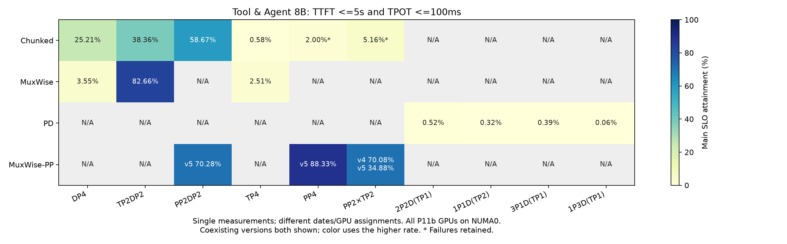

### Tool&Agent 8B各系统最佳配置

| 系统 | 最佳配置 | 主SLO（达标/全部） | TTFT p50/p99(s) | TPOT p50/p99(ms); n | 完成/未完/失败 | 输出 tok/s |
| --- | --- | --- | --- | --- | --- | --- |
| Chunked | PP2DP2 | 58.672% (910/1551) | 0.783/7.249 | 68.767/2637.747; n=1543 | 1551/0/0 | 423.566 |
| MuxWise | TP2DP2 | 82.656% (1282/1551) | 1.791/10.063 | 20.212/104.941; n=1543 | 1551/0/0 | 426.470 |
| PD | 2P2D(TP1) | 0.516% (8/1551) | >cutoff/>cutoff | 19.431/23.141; n=614 | 617/934/0 | 118.145 |
| MuxWise-PP | PP4 v5 | 88.330% (1370/1551) | 2.720/7.480 | 47.740/78.466; n=1543 | 1551/0/0 | 422.144 |

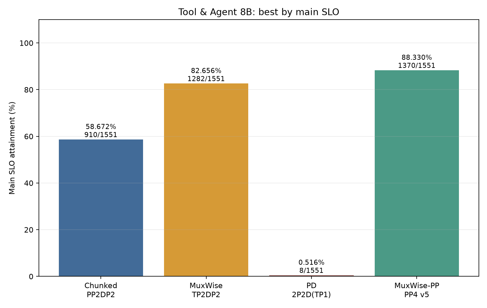

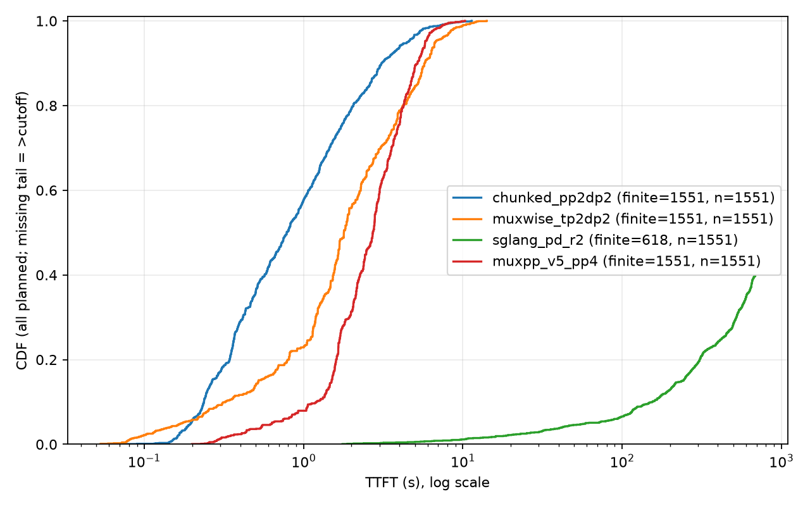

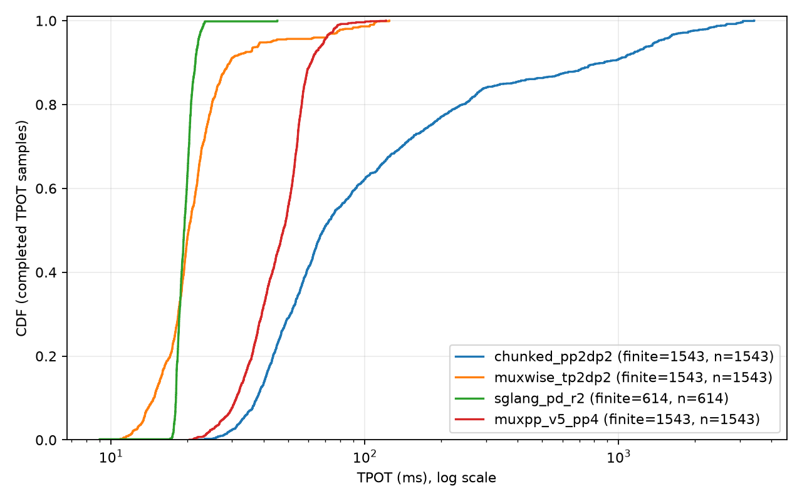

按已测集合的主SLO排序：MuxWise-PP PP4 v5 88.330%；MuxWise TP2DP2 82.656%；Chunked PP2DP2 58.672%；PD 2P2D(TP1) 0.516%。最佳仅针对5s/100ms门限；TTFT、TPOT、吞吐需分别判断，不能推广为所有指标共同排名。

## Conversation 8B完整矩阵（7行）

| 系统 | 配置 | label | 完成/未完/失败 | TTFT p50/p90/p99(s) | TPOT p50/p99(ms); n | E2E p50(s) | 输入/输出 tok/s | 主 SLO | TTFT≤2s | 10s/100ms SLO | cache命中率† | 每实例KV(token) |
| --- | --- | --- | --- | --- | --- | --- | --- | --- | --- | --- | --- | --- |
| MuxWise | TP2DP2 | conv_muxwise_tp2dp2 | 735/0/0 | 1.897/6.334/11.584 | 18.688/30.189; n=731 | 8.053 | 10974.176/405.297 | 82.313% | 51.293% | 97.279% | 5.602% | worker0(model)=161473; worker1(model)=161473 |
| MuxWise | TP4 | conv_muxwise_tp4 | 735/0/0 | 16.258/28.551/36.006 | 14.856/29.090; n=731 | 21.285 | 10917.016/403.186 | 2.313% | 1.361% | 17.959% | 6.029% | worker0(model)=475809 |
| Chunked | PP2DP2 | conv_chunked_pp2dp2 | 735/0/0 | 0.965/3.772/9.527 | 53.265/552.443; n=731 | 18.957 | 10832.824/400.077 | 85.034% | 70.748% | 89.660% | 5.899% | worker0(model)=191374; worker1(model)=191374 |
| Chunked | TP2DP2 | conv_chunked_tp2dp2 | 735/0/0 | 2.267/8.991/16.234 | 65.234/258.735; n=731 | 20.560 | 10897.981/402.483 | 61.633% | 46.395% | 78.231% | 5.972% | worker0(model)=207118; worker1(model)=207118 |
| MuxWise-PP | PP2×TP2 v4 | conv_muxpp_v4_pp2tp2 | 735/0/0 | 3.915/7.746/11.565 | 40.530/63.822; n=731 | 15.951 | 10854.044/400.860 | 65.850% | 16.871% | 96.599% | 5.648% | worker0(model)=390622 |
| MuxWise-PP | PP4 v5 | conv_muxpp_v5_pp4 | 735/0/0 | 2.773/5.539/7.775 | 38.909/58.797; n=731 | 14.975 | 10815.868/399.450 | 85.306% | 28.844% | 99.184% | 5.641% | worker0(model)=359498 |
| MuxWise-PP | PP2×TP2 v5 | conv_muxpp_v5_pp2tp2 | 735/0/0 | 6.324/13.241/18.296 | 47.495/61.584; n=731 | 21.574 | 10853.607/400.844 | 35.374% | 10.068% | 77.279% | 5.641% | worker0(model)=390804 |

[全部分位/配置/GPU](results/conv_summary.md) · [CSV](results/conv_summary.csv)

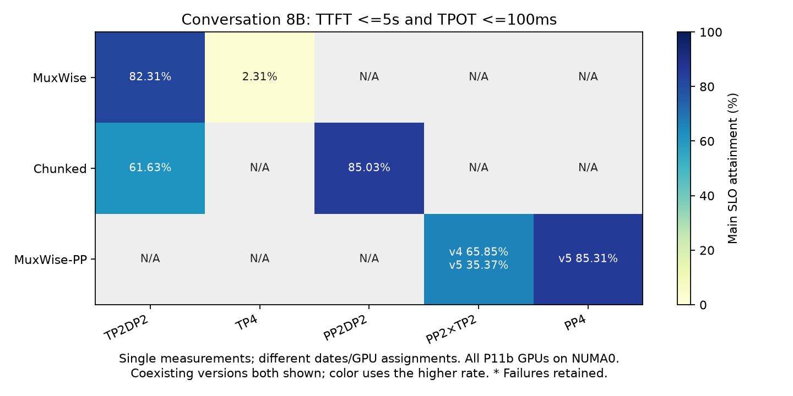

### Conversation 8B各系统最佳配置

| 系统 | 最佳配置 | 主SLO（达标/全部） | TTFT p50/p99(s) | TPOT p50/p99(ms); n | 完成/未完/失败 | 输出 tok/s |
| --- | --- | --- | --- | --- | --- | --- |
| MuxWise | TP2DP2 | 82.313% (605/735) | 1.897/11.584 | 18.688/30.189; n=731 | 735/0/0 | 405.297 |
| Chunked | PP2DP2 | 85.034% (625/735) | 0.965/9.527 | 53.265/552.443; n=731 | 735/0/0 | 400.077 |
| MuxWise-PP | PP4 v5 | 85.306% (627/735) | 2.773/7.775 | 38.909/58.797; n=731 | 735/0/0 | 399.450 |

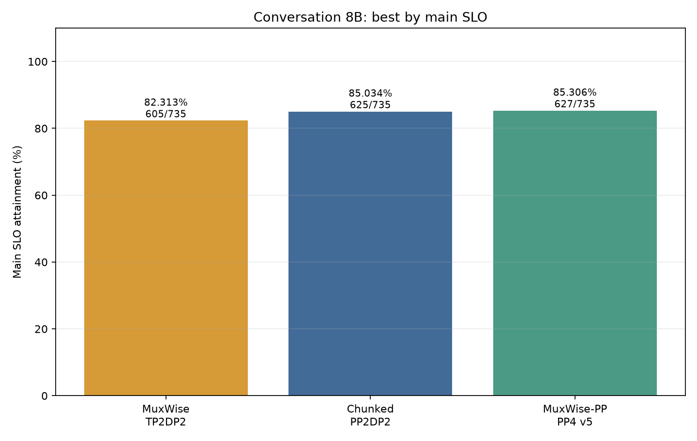

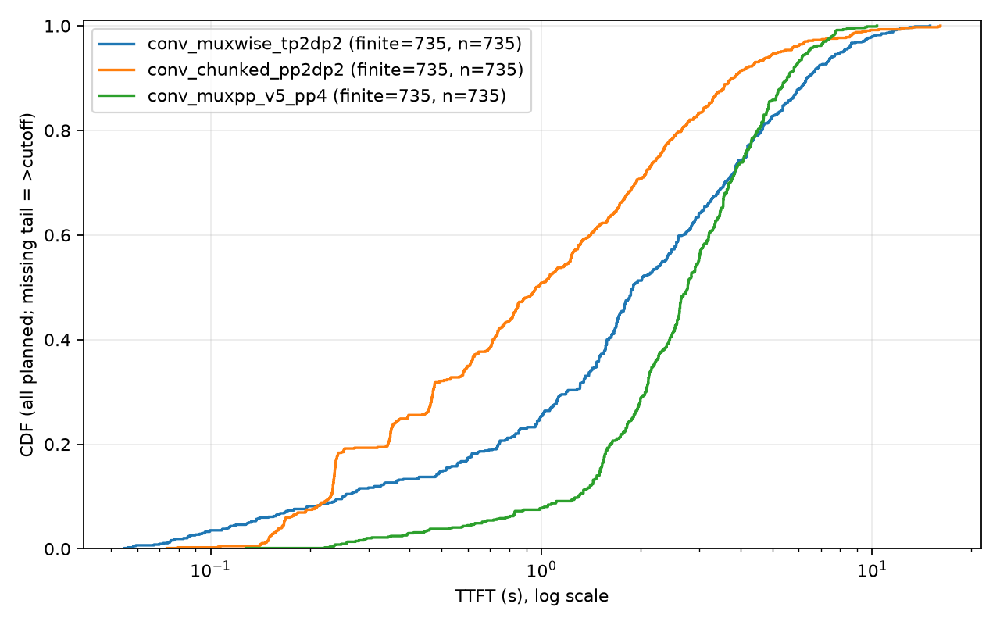

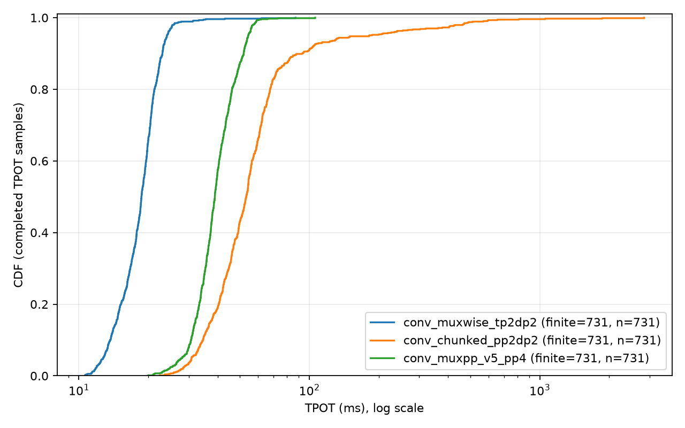

按已测集合的主SLO排序：MuxWise-PP PP4 v5 85.306%；Chunked PP2DP2 85.034%；MuxWise TP2DP2 82.313%。最佳仅针对5s/100ms门限；TTFT、TPOT、吞吐需分别判断，不能推广为所有指标共同排名。

## 大模型24B完整矩阵（7行）

| 系统 | 配置 | label | 完成/未完/失败 | TTFT p50/p90/p99(s) | TPOT p50/p99(ms); n | E2E p50(s) | 输入/输出 tok/s | 主 SLO | TTFT≤2s | 10s/100ms SLO | cache命中率† | 每实例KV(token) |
| --- | --- | --- | --- | --- | --- | --- | --- | --- | --- | --- | --- | --- |
| MuxWise | TP4 | big_muxwise_tp4 | 555/0/0 | 8.867/24.412/34.635 | 29.603/299.279; n=552 | 13.458 | 6555.383/160.569 | 19.640% | 7.568% | 48.108% | 41.062% | server(model)=167692 |
| Chunked | TP4 | big_chunked_tp4 | 555/0/0 | 6.746/18.599/29.183 | 151.311/344.629; n=552 | 15.443 | 6543.345/160.274 | 9.550% | 14.054% | 21.441% | 39.623% | server(model)=252288 |
| Chunked | PP4 | big_chunked_pp4 | 555/0/0 | 49.049/118.039/129.931 | 150.948/2723.597; n=552 | 77.690 | 5215.154/127.741 | 1.441% | 3.243% | 1.441% | 34.175% | server(model)=204263 |
| Chunked | PP2×TP2 | big_chunked_pp2tp2 | 555/0/0 | 4.996/19.158/31.508 | 125.176/6759.185; n=552 | 15.335 | 6485.989/158.870 | 13.694% | 19.820% | 25.225% | 39.022% | server(model)=236846 |
| MuxWise-PP | PP2×TP2 v4 | big_muxpp_pp2tp2 | 555/0/0 | 9.457/21.747/36.711 | 60.754/120.592; n=552 | 14.870 | 6469.651/158.469 | 17.477% | 3.243% | 50.991% | 39.949% | server(model)=203111 |
| MuxWise-PP | PP2×TP2 v5 | big_muxpp_v5_pp2tp2 | 555/0/0 | 10.989/24.274/37.068 | 63.423/99.155; n=552 | 17.691 | 6460.320/158.241 | 19.459% | 5.225% | 44.685% | 38.272% | server(model)=203279 |
| MuxWise-PP | PP4 v5 | big_muxpp_v5_pp4 | 555/0/0 | 14.641/51.917/65.814 | 79.721/119.497; n=552 | 30.018 | 6178.691/151.343 | 9.730% | 1.081% | 26.126% | 34.330% | server(model)=181066 |

[全部分位/配置/GPU](results/big_summary.md) · [CSV](results/big_summary.csv)

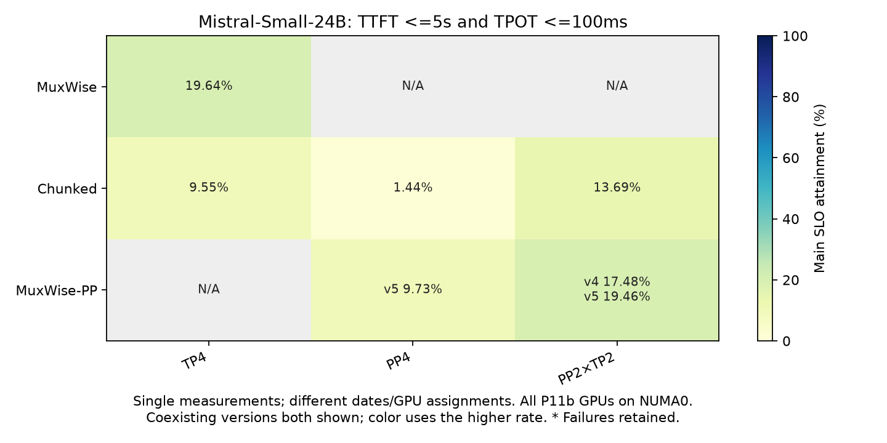

### 大模型24B各系统最佳配置

| 系统 | 最佳配置 | 主SLO（达标/全部） | TTFT p50/p99(s) | TPOT p50/p99(ms); n | 完成/未完/失败 | 输出 tok/s |
| --- | --- | --- | --- | --- | --- | --- |
| MuxWise | TP4 | 19.640% (109/555) | 8.867/34.635 | 29.603/299.279; n=552 | 555/0/0 | 160.569 |
| Chunked | PP2×TP2 | 13.694% (76/555) | 4.996/31.508 | 125.176/6759.185; n=552 | 555/0/0 | 158.870 |
| MuxWise-PP | PP2×TP2 v5 | 19.459% (108/555) | 10.989/37.068 | 63.423/99.155; n=552 | 555/0/0 | 158.241 |

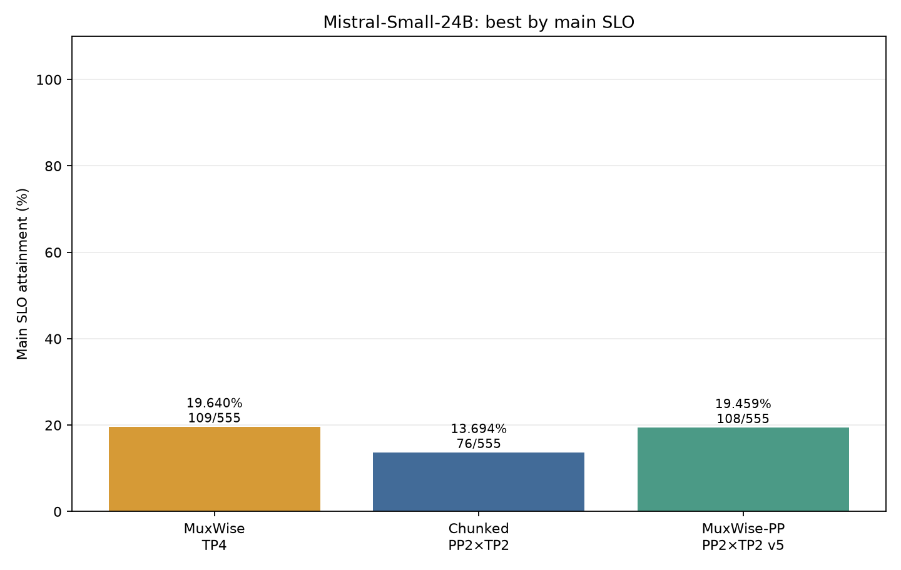

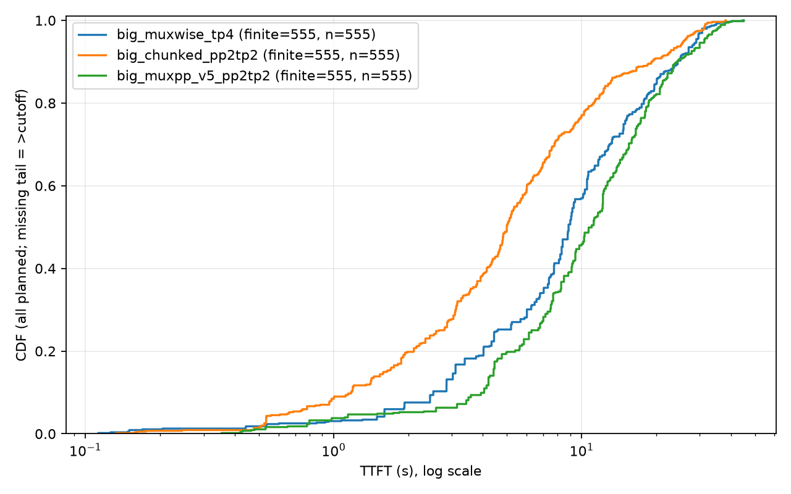

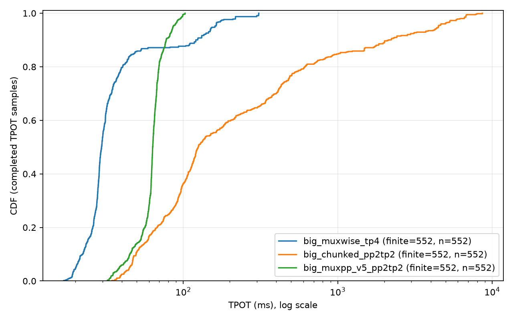

按已测集合的主SLO排序：MuxWise TP4 19.640%；MuxWise-PP PP2×TP2 v5 19.459%；Chunked PP2×TP2 13.694%。最佳仅针对5s/100ms门限；TTFT、TPOT、吞吐需分别判断，不能推广为所有指标共同排名。

历史MuxWise TP4主SLO通过109/555条，本次v5 PP2×TP2为108/555条，仅差1条；硬件分配、日期与提交不同，不能据此建立稳定优劣。v5 PP4虽较同拓扑v4明显改善，绝对主SLO仍只有54/555条。

## B：饱和吞吐对比

同正式trace压缩到约30秒到达，保持请求长度和客户端参数不变。标准速率下吞吐相近不能证明容量相同；本节测量固定到达压缩和300秒排空截止下的吞吐。MuxWise与Chunked拓扑按用户指定；MuxWise-PP按A主SLO最高、同分TTFT p50最低选择，见[选择记录](logs/p11b/saturation-selection.json)。这是指定候选配置的饱和对比，并未遍历所有配置证明全局最大吞吐。

### Tool&Agent 8B

| label | 完成/未完/失败 | 全部完成耗时(s) | 测量时长(s) | 输入/输出 tok/s | 完成req/s | TTFT p50/p90/p95/p99(s) | TPOT p50/p90/p95/p99(ms); n |
| --- | --- | --- | --- | --- | --- | --- | --- |
| sat_muxwise_tp2dp2 | 1088/463/0 | — | 330.013 | 24242.785/516.892 | 3.297 | 220.923/>cutoff/>cutoff/>cutoff | 24.598/37.350/90.297/118.066; n=1082 |
| sat_chunked_pp2dp2 | 1159/390/2 | — | 330.004 | 24703.146/485.280 | 3.512 | 172.261/>cutoff/>cutoff/>cutoff | 79.377/212.063/505.143/4790.238; n=1152 |
| sat_muxpp_v5_pp4 | 1211/340/0 | — | 330.012 | 27119.113/592.793 | 3.670 | 196.363/>cutoff/>cutoff/>cutoff | 52.050/65.022/74.827/90.960; n=1205 |

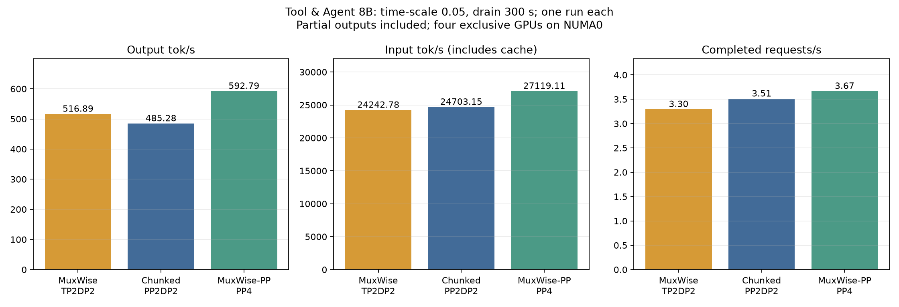

输出吞吐排序：MuxWise-PP 592.793 tok/s；MuxWise 516.892 tok/s；Chunked 485.280 tok/s。本次最高的MuxWise-PP比第二名高14.684%。截止前完成数与TTFT尾部同时见表；部分输出吞吐不等于完成请求吞吐。

v5 PP4本次完成1211条，输出吞吐和完成请求吞吐均为三者最高；但TTFT中位196.363s高于Chunked的172.261s，TPOT中位52.050ms高于MuxWise的24.598ms。其TPOT p99为90.960ms，低于另两者；三者TTFT p90/p95/p99均为`>cutoff`。因此吞吐领先并不代表所有延迟分位同时领先。

`sat_chunked_pp2dp2`保留2条真实客户端失败：idx4176与4370的服务响应`cached_tokens`分别为12288与1024，超过对应输入长度7311与901，被原客户端校验拒绝（HTTP200，非正常完成）。同次服务日志有KV满后的request retraction，未发现CUDA OOM；未对具体因果作额外归因，也未修改校验、剔除失败或重跑。见[精简失败记录](logs/p11b/sat_chunked_pp2dp2/failure-records.json)与[worker0日志](logs/p11b/sat_chunked_pp2dp2/worker0.log)。
### Tool&Agent 24B

| label | 完成/未完/失败 | 全部完成耗时(s) | 测量时长(s) | 输入/输出 tok/s | 完成req/s | TTFT p50/p90/p95/p99(s) | TPOT p50/p90/p95/p99(ms); n |
| --- | --- | --- | --- | --- | --- | --- | --- |
| sat_big_muxwise_tp4 | 293/262/0 | — | 329.255 | 6636.127/133.079 | 0.890 | 299.731/>cutoff/>cutoff/>cutoff | 31.269/138.368/148.144/172.638; n=293 |
| sat_big_chunked_pp2tp2 | 318/237/0 | — | 329.256 | 7612.011/141.950 | 0.966 | 263.337/>cutoff/>cutoff/>cutoff | 158.891/1105.653/4012.802/15242.762; n=317 |
| sat_big_muxpp_v5_pp2tp2 | 371/184/0 | — | 329.255 | 8299.671/175.499 | 1.127 | 237.874/>cutoff/>cutoff/>cutoff | 66.130/88.112/96.029/121.852; n=370 |

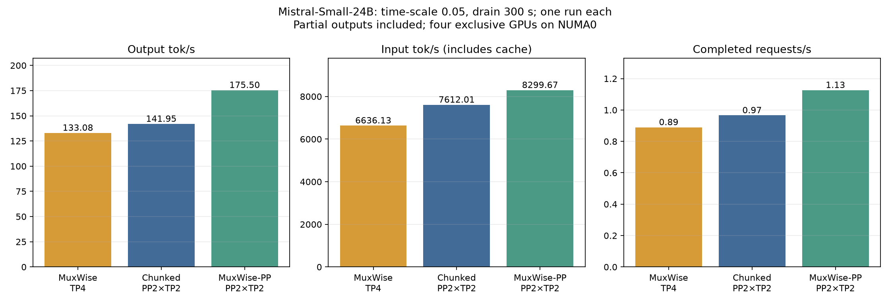

输出吞吐排序：MuxWise-PP 175.499 tok/s；Chunked 141.950 tok/s；MuxWise 133.079 tok/s。本次最高的MuxWise-PP比第二名高23.634%。截止前完成数与TTFT尾部同时见表；部分输出吞吐不等于完成请求吞吐。

v5 PP2×TP2本次输出吞吐、完成数和TTFT中位数均为三者最佳；其TPOT中位66.130ms高于MuxWise的31.269ms，但p99为121.852ms，低于MuxWise的172.638ms和Chunked的15242.762ms。TPOT按首末token间隔平均，包含生成期间的调度/回退停顿，不等同于GPU纯计算时间。

六组均未在截止前完成全部请求，故“全部完成耗时”均留空；不会据部分完成速度外推一个完成全部请求的时间。TPOT分位仅描述各系统截止前完成且输出超过1 token的请求；未完成较多时，样本集合不同，不能解释为全体请求的decode延迟排名。输入吞吐包含缓存命中token，不能解释为每秒实际重新执行prefill的token数。

[饱和完整JSON](results/sat_summary.json) · [全部统计CSV](results/sat_summary.csv)。PNG另有同名SVG。

## MuxWise-PP v5 调度优化

以下机制和开发数字来自[P11A_NOTES.md](P11A_NOTES.md)，不充当P11b正式结果。stage0对整批FCFS输入生成token块计划，短请求与长请求尾部可以打包；各stage FIFO执行，子块共享已分配的完整输入KV并保留radix锁，按块READY/接收槽和CUDA event管理生命周期，整父批完成后在MERGE处返回首token。这减少长prefill造成的流水线等待；块内仍沿用v4按层切片、RLS/ALP与原分区控制，没有新增动态chunk-size控制器。

可选token在途额度取代批数门控；按末级完成的实际token归还额度，16384-token回补门槛减少零碎准入。完整KV和未来decode输出预留保持；超额度FCFS单请求仅在无未完成工作时进入，避免饿死。中间块跳过norm/head/采样，终结span使用basic slice视图，避免Python列表GPU索引同步。可选CPU长度、前缀和与FlashInfer规划元数据减少GPU→CPU读回，KV索引仍在GPU构造。

| 所选拓扑（开发轮次） | 开发标准主SLO v4→v5 | 开发标准输出tok/s v4→v5 | 开发饱和输出tok/s v4→v5 |
| --- | --- | --- | --- |
| 8B PP4 (R5) | 85.333%→93.000% | 342.74→345.06 | 474.46→514.26 |
| 8B PP2×TP2 (R2) | 73.333%→84.333% | 354.80→352.04 | 488.12→478.78 |
| 24B PP2×TP2 (R6) | 30.000%→43.333% | 111.75→112.38 | 160.60→167.54 |
| 24B PP4 (R5) | 4.000%→23.333% | 95.66→105.84 | 109.07→133.45 |

已知取舍：8B PP2×TP2开发主SLO提高，但三档输出吞吐略降；24B PP2×TP2启用CPU元数据后标准宽松SLO为68.0%，低于v4的69.333%及R2的80.0%。PP2×DP2附测无成对v4基线，标准主SLO89.667%，饱和仅351.37 tok/s，伴随worker负载不均；因此不能仅凭低中位TTFT推断饱和容量最佳。最终24B PP4 cold20仍为19/20 exact，与v4已知分叉相同，不宣称全模型逐token位等价。开发样本仅8B前300/24B前150条，不能与正式1551/555条混排。

## 审计、历史证据与清理

原始数据位于 `results/<label>_requests.jsonl` 与summary；每label正式锁指向 `logs/p11b/<label>`。运行目录保存命令、环境、预热/冒烟、server_info、GPU/rank映射及5秒采样，旁侧保存逐秒外部监测与启动前基线。[运行进度](logs/p11b/progress.jsonl) · [最终审计](logs/p11b/final-audit.json)。

历史Chunked PP4/TP2PP2失败数据和PD截止未完成均保留在矩阵。旧版实现与异常、P10c Llama A/B及24B显存优化说明见[更新前完整报告](logs/p11b/RESULTS-before-P11b.md)、[P10B](P10B_NOTES.md)、[P11A](P11A_NOTES.md)。这些测量跨源码提交、日期和GPU/NUMA分配；单次排序不证明稳定优势。

CPU重建：`source env.sh && OPENBLAS_NUM_THREADS=1 OMP_NUM_THREADS=1 python scripts/p11b_report.py`。该入口只读已保存请求，不启动模型或重跑label。最终GPU/进程/端口状态见最终审计。

### 本次正式客户端启动时间（UTC）

各行使用上表相同UUID与NUMA0分配；历史数据日期保留在各summary的`run_started_unix`及原正式锁中。

| label | 正式启动UTC | GPU启动前基线 |
| --- | --- | --- |
| muxpp_v5_pp4 | 2026-10-27T22:34:38.667630+00:00 | 四卡显存0.9375–0.9375MiB，利用率0–0% |
| muxpp_v5_pp2tp2 | 2026-10-27T22:47:02.527379+00:00 | 四卡显存0.9375–0.9375MiB，利用率0–0% |
| muxpp_v5_pp2dp2 | 2026-10-27T22:59:56.929215+00:00 | 四卡显存0.9375–0.9375MiB，利用率0–0% |
| conv_muxpp_v5_pp4 | 2026-10-27T23:12:29.269435+00:00 | 四卡显存0.9375–0.9375MiB，利用率0–0% |
| conv_muxpp_v5_pp2tp2 | 2026-10-27T23:25:00.983742+00:00 | 四卡显存0.9375–0.9375MiB，利用率0–0% |
| big_muxpp_v5_pp2tp2 | 2026-10-27T23:43:07.031345+00:00 | 四卡显存0.9375–0.9375MiB，利用率0–0% |
| big_muxpp_v5_pp4 | 2026-10-27T23:56:44.360450+00:00 | 四卡显存0.9375–0.9375MiB，利用率0–0% |
| sat_muxwise_tp2dp2 | 2026-10-28T00:09:36.062567+00:00 | 四卡显存0.9375–0.9375MiB，利用率0–0% |
| sat_chunked_pp2dp2 | 2026-10-28T00:17:23.555839+00:00 | 四卡显存0.9375–0.9375MiB，利用率0–0% |
| sat_muxpp_v5_pp4 | 2026-10-28T00:25:09.711805+00:00 | 四卡显存0.9375–0.9375MiB，利用率0–0% |
| sat_big_muxwise_tp4 | 2026-10-28T00:33:04.439396+00:00 | 四卡显存0.9375–0.9375MiB，利用率0–0% |
| sat_big_chunked_pp2tp2 | 2026-10-28T00:40:55.151424+00:00 | 四卡显存0.9375–0.9375MiB，利用率0–0% |
| sat_big_muxpp_v5_pp2tp2 | 2026-10-28T00:49:38.405521+00:00 | 四卡显存0.9375–0.9375MiB，利用率0–0% |

全部GPU实验结束后执行35秒空闲检查；最终审计再次核对四卡显存/利用率、容器内进程和服务端口。运行中未检测到外部GPU占用。NVML设备显存与进程显存计数非原子采样，少量差额按驱动/采样差异记录；不代表允许外部进程。
