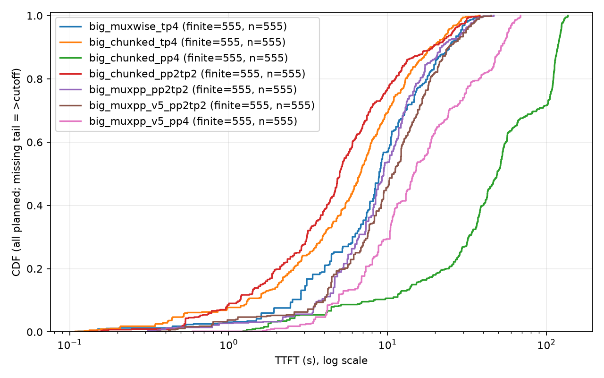
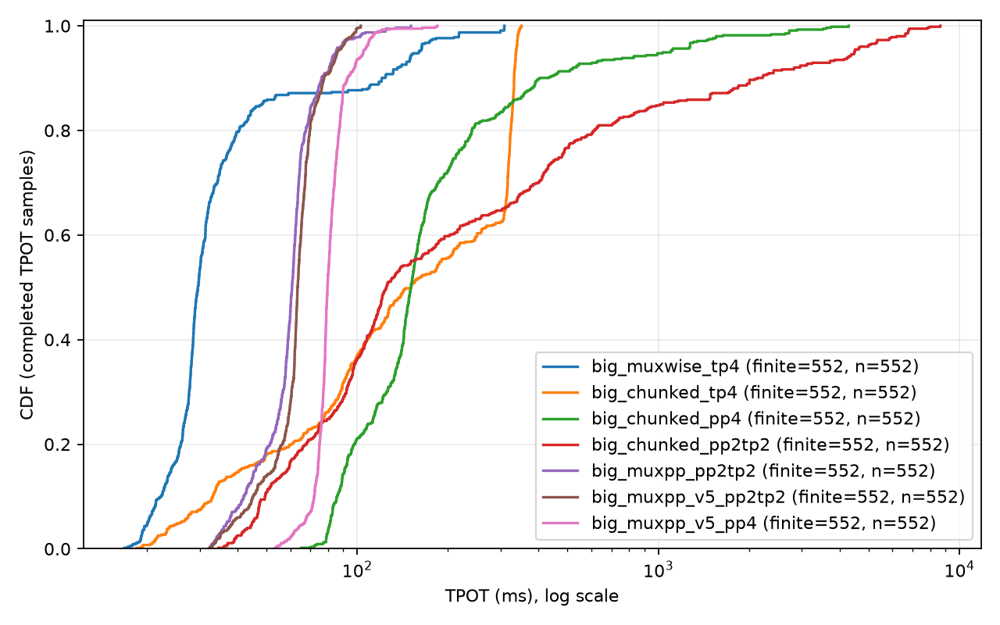
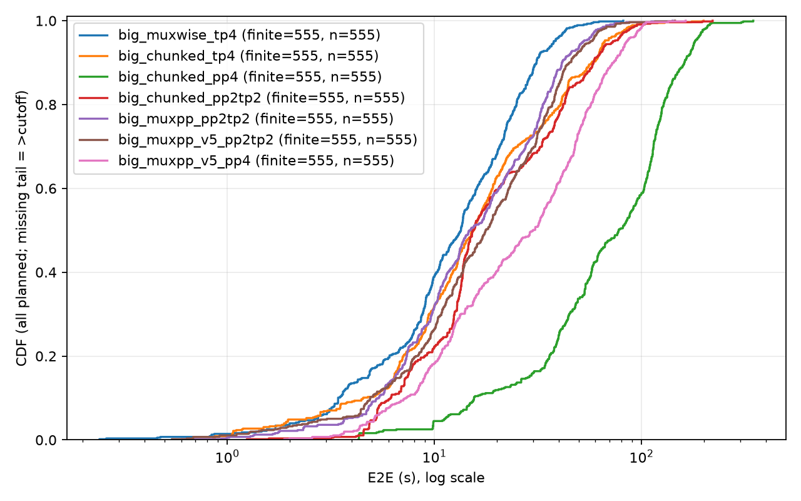
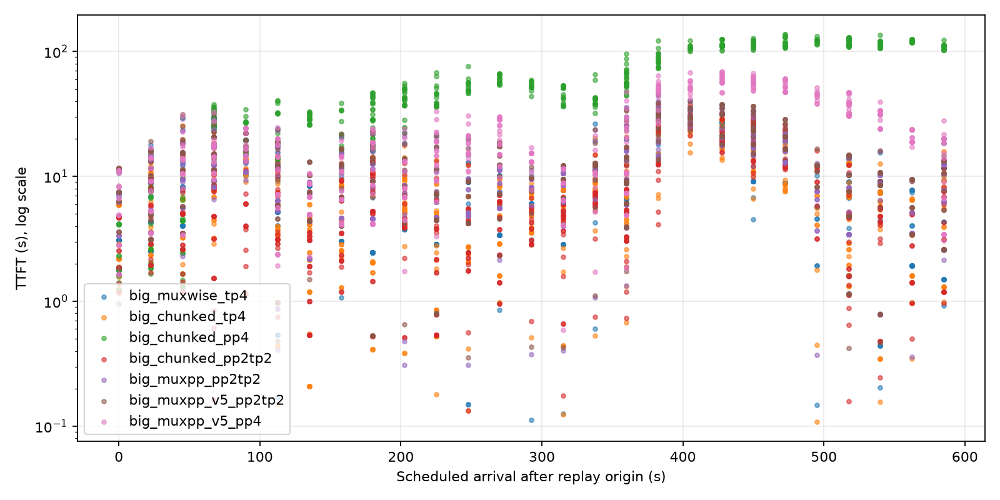
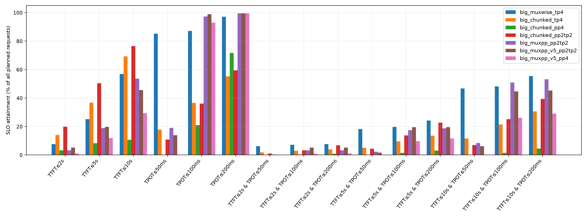

# Mistral-Small-24B完整矩阵

| 系统 | 配置 | label | 完成/未完/失败 | TTFT p50/p90/p99(s) | TPOT p50/p99(ms); n | E2E p50(s) | 输入/输出 tok/s | 主 SLO | TTFT≤2s | 10s/100ms SLO | cache命中率† | 每实例KV(token) |
| --- | --- | --- | --- | --- | --- | --- | --- | --- | --- | --- | --- | --- |
| MuxWise | TP4 | big_muxwise_tp4 | 555/0/0 | 8.867/24.412/34.635 | 29.603/299.279; n=552 | 13.458 | 6555.383/160.569 | 19.640% | 7.568% | 48.108% | 41.062% | server(model)=167692 |
| Chunked | TP4 | big_chunked_tp4 | 555/0/0 | 6.746/18.599/29.183 | 151.311/344.629; n=552 | 15.443 | 6543.345/160.274 | 9.550% | 14.054% | 21.441% | 39.623% | server(model)=252288 |
| Chunked | PP4 | big_chunked_pp4 | 555/0/0 | 49.049/118.039/129.931 | 150.948/2723.597; n=552 | 77.690 | 5215.154/127.741 | 1.441% | 3.243% | 1.441% | 34.175% | server(model)=204263 |
| Chunked | PP2×TP2 | big_chunked_pp2tp2 | 555/0/0 | 4.996/19.158/31.508 | 125.176/6759.185; n=552 | 15.335 | 6485.989/158.870 | 13.694% | 19.820% | 25.225% | 39.022% | server(model)=236846 |
| MuxWise-PP | PP2×TP2 v4 | big_muxpp_pp2tp2 | 555/0/0 | 9.457/21.747/36.711 | 60.754/120.592; n=552 | 14.870 | 6469.651/158.469 | 17.477% | 3.243% | 50.991% | 39.949% | server(model)=203111 |
| MuxWise-PP | PP2×TP2 v5 | big_muxpp_v5_pp2tp2 | 555/0/0 | 10.989/24.274/37.068 | 63.423/99.155; n=552 | 17.691 | 6460.320/158.241 | 19.459% | 5.225% | 44.685% | 38.272% | server(model)=203279 |
| MuxWise-PP | PP4 v5 | big_muxpp_v5_pp4 | 555/0/0 | 14.641/51.917/65.814 | 79.721/119.497; n=552 | 30.018 | 6178.691/151.343 | 9.730% | 1.081% | 26.126% | 34.330% | server(model)=181066 |

主SLO：TTFT≤5s且TPOT≤100ms。每配置一次测量，无置信区间。SLO/TTFT/E2E分母为全部555条计划请求；TPOT仅取已完成且输出>1的样本。吞吐包含排空，输入包含缓存。KV为每实例逻辑容量，不乘TP/PP rank数。† PD cache仅为decode响应。

## 运行配置与GPU采样

| label | mem fraction | GPU均值% | 样本数 | 发送延迟p99/max(ms) | 正式日志 |
| --- | --- | --- | --- | --- | --- |
| big_muxwise_tp4 | {'server': 0.76} | 94.169 | 480 | 13.471/13.932 | /root/workspace/muxpp_work/logs/p10c/big_muxwise_tp4 |
| big_chunked_tp4 | {'server': 0.9} | 94.100 | 480 | 29.632/30.191 | /root/workspace/muxpp_work/logs/p10c/big_chunked_tp4 |
| big_chunked_pp4 | {'server': 0.9} | 67.679 | 604 | 24.543/25.567 | /root/workspace/muxpp_work/logs/p10c/big_chunked_pp4 |
| big_chunked_pp2tp2 | {'server': 0.9} | 84.419 | 484 | 18.581/19.076 | /root/workspace/muxpp_work/logs/p10c/big_chunked_pp2tp2 |
| big_muxpp_pp2tp2 | {'server': 0.82} | 93.537 | 484 | 18.239/18.773 | /root/workspace/muxpp_work/logs/p10c/big_muxpp_pp2tp2 |
| big_muxpp_v5_pp2tp2 | {'server': 0.82} | 94.143 | 488 | 13.893/22.392 | /root/workspace/muxpp_work/logs/p11b/big_muxpp_v5_pp2tp2 |
| big_muxpp_v5_pp4 | {'server': 0.81} | 97.512 | 508 | 19.796/23.822 | /root/workspace/muxpp_work/logs/p11b/big_muxpp_v5_pp4 |

GPU每5秒采样，仅取客户端测量窗口（包括排空，不含长预热/冒烟）；GPU利用率包含通信等待，不能等同于有效计算效率。

## 完整延迟分位

| 系统 | 指标 | 样本数 | mean | p50 | p90 | p95 | p99 | max |
| --- | --- | --- | --- | --- | --- | --- | --- | --- |
| big_muxwise_tp4 | TTFT (s) | 555 | 11.120 | 8.867 | 24.412 | 29.029 | 34.635 | 44.628 |
| big_muxwise_tp4 | TPOT (ms) | 552 | 46.955 | 29.603 | 120.750 | 160.347 | 299.279 | 308.446 |
| big_muxwise_tp4 | E2E (s) | 555 | 15.934 | 13.458 | 31.157 | 37.748 | 50.642 | 81.812 |
| big_chunked_tp4 | TTFT (s) | 555 | 8.515 | 6.746 | 18.599 | 24.111 | 29.183 | 37.453 |
| big_chunked_tp4 | TPOT (ms) | 552 | 185.077 | 151.311 | 332.122 | 337.038 | 344.629 | 351.640 |
| big_chunked_tp4 | E2E (s) | 555 | 23.692 | 15.443 | 57.529 | 66.132 | 92.487 | 199.785 |
| big_chunked_pp4 | TTFT (s) | 555 | 58.863 | 49.049 | 118.039 | 123.394 | 129.931 | 137.000 |
| big_chunked_pp4 | TPOT (ms) | 552 | 273.880 | 150.948 | 403.090 | 1065.295 | 2723.597 | 4293.361 |
| big_chunked_pp4 | E2E (s) | 555 | 84.987 | 77.690 | 161.108 | 180.983 | 211.569 | 347.003 |
| big_chunked_pp2tp2 | TTFT (s) | 555 | 7.539 | 4.996 | 19.158 | 25.767 | 31.508 | 38.169 |
| big_chunked_pp2tp2 | TPOT (ms) | 552 | 716.462 | 125.176 | 2130.685 | 4485.196 | 6759.185 | 8655.521 |
| big_chunked_pp2tp2 | E2E (s) | 555 | 26.161 | 15.335 | 58.716 | 72.760 | 95.228 | 220.889 |
| big_muxpp_pp2tp2 | TTFT (s) | 555 | 11.477 | 9.457 | 21.747 | 30.232 | 36.711 | 46.777 |
| big_muxpp_pp2tp2 | TPOT (ms) | 552 | 60.948 | 60.754 | 76.191 | 84.962 | 120.592 | 150.990 |
| big_muxpp_pp2tp2 | E2E (s) | 555 | 20.927 | 14.870 | 41.319 | 52.166 | 68.989 | 141.665 |
| big_muxpp_v5_pp2tp2 | TTFT (s) | 555 | 12.702 | 10.989 | 24.274 | 31.296 | 37.068 | 45.156 |
| big_muxpp_v5_pp2tp2 | TPOT (ms) | 552 | 63.389 | 63.423 | 77.600 | 85.840 | 99.155 | 102.882 |
| big_muxpp_v5_pp2tp2 | E2E (s) | 555 | 22.704 | 17.691 | 44.838 | 56.589 | 74.954 | 145.366 |
| big_muxpp_v5_pp4 | TTFT (s) | 555 | 21.640 | 14.641 | 51.917 | 57.801 | 65.814 | 68.853 |
| big_muxpp_v5_pp4 | TPOT (ms) | 552 | 81.906 | 79.721 | 92.891 | 104.760 | 119.497 | 184.727 |
| big_muxpp_v5_pp4 | E2E (s) | 555 | 34.971 | 30.018 | 72.828 | 84.640 | 101.951 | 163.738 |

## 全部 SLO 阈值

| 系统 | ttft_le_2s | ttft_le_5s | ttft_le_10s | tpot_le_50ms | tpot_le_100ms | tpot_le_200ms | ttft_le_2s_and_tpot_le_50ms | ttft_le_2s_and_tpot_le_100ms | ttft_le_2s_and_tpot_le_200ms | ttft_le_5s_and_tpot_le_50ms | ttft_le_5s_and_tpot_le_100ms | ttft_le_5s_and_tpot_le_200ms | ttft_le_10s_and_tpot_le_50ms | ttft_le_10s_and_tpot_le_100ms | ttft_le_10s_and_tpot_le_200ms |
| --- | --- | --- | --- | --- | --- | --- | --- | --- | --- | --- | --- | --- | --- | --- | --- |
| big_muxwise_tp4 | 7.568% | 25.225% | 56.937% | 85.225% | 87.207% | 97.117% | 6.126% | 7.207% | 7.568% | 18.198% | 19.640% | 24.144% | 46.667% | 48.108% | 55.495% |
| big_chunked_tp4 | 14.054% | 36.757% | 69.189% | 17.838% | 36.577% | 55.315% | 1.802% | 2.883% | 3.964% | 5.045% | 9.550% | 13.514% | 11.712% | 21.441% | 30.631% |
| big_chunked_pp4 | 3.243% | 8.288% | 10.631% | 0.000% | 20.901% | 71.712% | 0.000% | 0.360% | 0.901% | 0.000% | 1.441% | 3.063% | 0.000% | 1.441% | 4.505% |
| big_chunked_pp2tp2 | 19.820% | 50.450% | 76.577% | 10.811% | 36.036% | 59.459% | 1.081% | 3.243% | 6.847% | 4.324% | 13.694% | 22.703% | 7.027% | 25.225% | 39.279% |
| big_muxpp_pp2tp2 | 3.243% | 18.919% | 53.694% | 19.099% | 97.297% | 99.459% | 0.360% | 3.243% | 3.243% | 2.342% | 17.477% | 18.739% | 8.468% | 50.991% | 53.153% |
| big_muxpp_v5_pp2tp2 | 5.225% | 19.640% | 45.586% | 13.874% | 98.919% | 99.459% | 0.180% | 5.225% | 5.225% | 1.622% | 19.459% | 19.459% | 6.126% | 44.685% | 45.225% |
| big_muxpp_v5_pp4 | 1.081% | 11.892% | 29.369% | 0.000% | 92.973% | 99.459% | 0.000% | 0.901% | 1.081% | 0.000% | 9.730% | 11.712% | 0.000% | 26.126% | 29.009% |

TTFT/E2E 分位以全部计划请求为样本；缺少首token/未成功完成的值取+∞，显示为 >cutoff。TPOT 仅采用截止前成功完成且输出>1的请求，上表列出样本数。SLO 分母为全部计划请求，unfinished/failed/未发均不达标。吞吐计入截止前交付的全部输出（含部分输出）；输入只计截止前已收到首token的请求。分母为min(实际时长,截止时刻)。

ITL 是两个增加 completion_tokens 的 SSE 事件之间的观测间隔；合包时无法还原真实逐 token ITL。缓存使用成功响应的输入token加权比例；字段缺失显示为 —。PD decode响应的缓存字段不代表prefill实际命中。CSV 保留完整指标（延迟单位为秒，比例范围 0–1）。每版本仅一次正式测量，无置信区间。

## 运行条件

| 系统 | time-scale | 请求数 | 预热 | 中断 | trace |
| --- | --- | --- | --- | --- | --- |
| big_muxwise_tp4 | 1.0 | 555 | 2 | False | /root/workspace/muxpp_work/bench/big_toolagent_600_80_x7.5.jsonl |
| big_chunked_tp4 | 1.0 | 555 | 2 | False | /root/workspace/muxpp_work/bench/big_toolagent_600_80_x7.5.jsonl |
| big_chunked_pp4 | 1.0 | 555 | 2 | False | /root/workspace/muxpp_work/bench/big_toolagent_600_80_x7.5.jsonl |
| big_chunked_pp2tp2 | 1.0 | 555 | 2 | False | /root/workspace/muxpp_work/bench/big_toolagent_600_80_x7.5.jsonl |
| big_muxpp_pp2tp2 | 1.0 | 555 | 2 | False | /root/workspace/muxpp_work/bench/big_toolagent_600_80_x7.5.jsonl |
| big_muxpp_v5_pp2tp2 | 1.0 | 555 | 2 | False | /root/workspace/muxpp_work/bench/big_toolagent_600_80_x7.5.jsonl |
| big_muxpp_v5_pp4 | 1.0 | 555 | 2 | False | /root/workspace/muxpp_work/bench/big_toolagent_600_80_x7.5.jsonl |

比较要求相同 trace、time-scale 和请求数量；不同版本/系统的源码、后端、KV容量和配置差异必须结合主报告解释。

