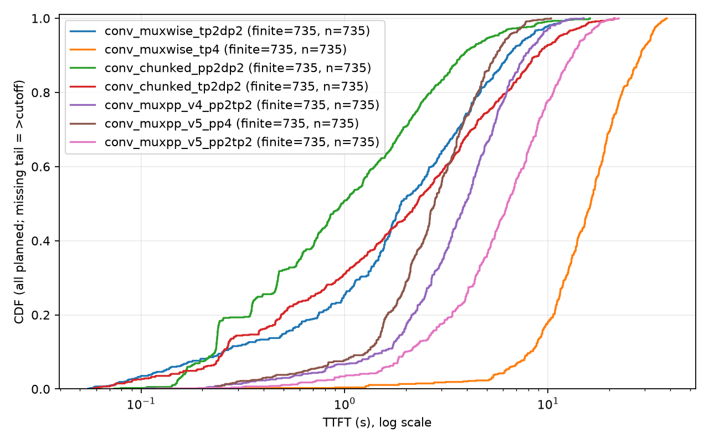
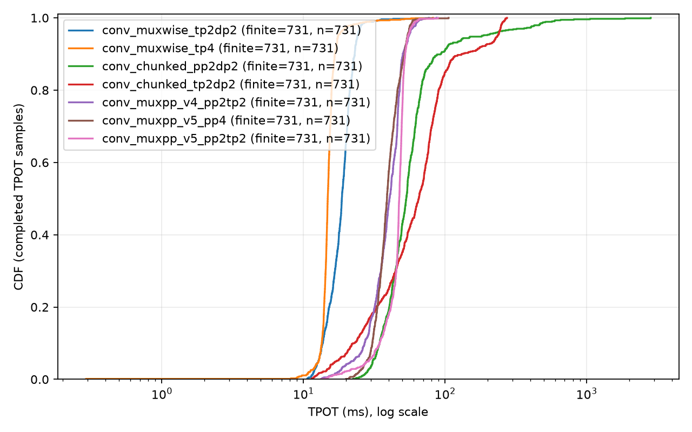
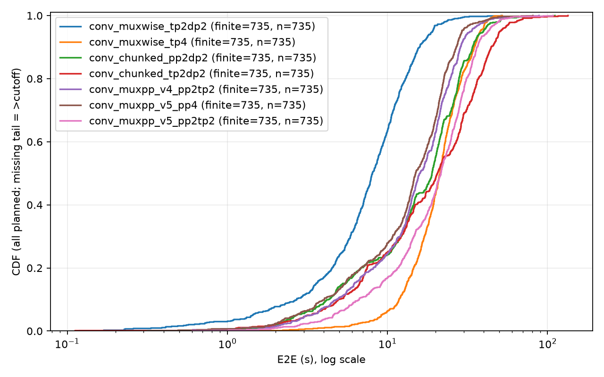
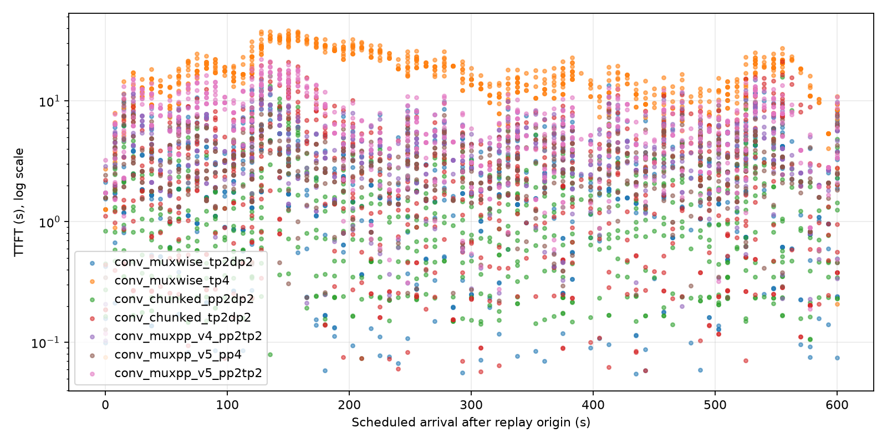
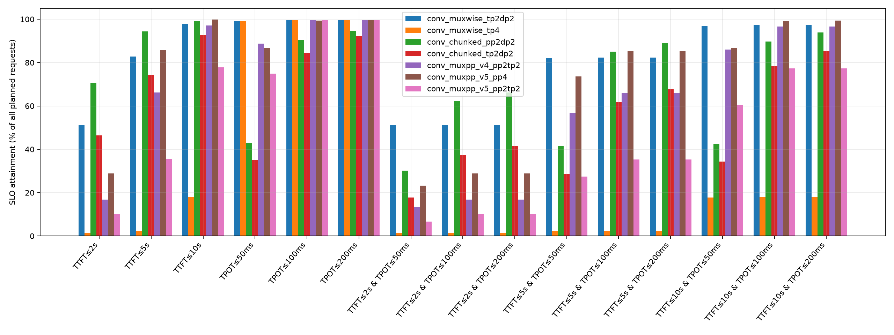

# Conversation 8B完整矩阵

| 系统 | 配置 | label | 完成/未完/失败 | TTFT p50/p90/p99(s) | TPOT p50/p99(ms); n | E2E p50(s) | 输入/输出 tok/s | 主 SLO | TTFT≤2s | 10s/100ms SLO | cache命中率† | 每实例KV(token) |
| --- | --- | --- | --- | --- | --- | --- | --- | --- | --- | --- | --- | --- |
| MuxWise | TP2DP2 | conv_muxwise_tp2dp2 | 735/0/0 | 1.897/6.334/11.584 | 18.688/30.189; n=731 | 8.053 | 10974.176/405.297 | 82.313% | 51.293% | 97.279% | 5.602% | worker0(model)=161473; worker1(model)=161473 |
| MuxWise | TP4 | conv_muxwise_tp4 | 735/0/0 | 16.258/28.551/36.006 | 14.856/29.090; n=731 | 21.285 | 10917.016/403.186 | 2.313% | 1.361% | 17.959% | 6.029% | worker0(model)=475809 |
| Chunked | PP2DP2 | conv_chunked_pp2dp2 | 735/0/0 | 0.965/3.772/9.527 | 53.265/552.443; n=731 | 18.957 | 10832.824/400.077 | 85.034% | 70.748% | 89.660% | 5.899% | worker0(model)=191374; worker1(model)=191374 |
| Chunked | TP2DP2 | conv_chunked_tp2dp2 | 735/0/0 | 2.267/8.991/16.234 | 65.234/258.735; n=731 | 20.560 | 10897.981/402.483 | 61.633% | 46.395% | 78.231% | 5.972% | worker0(model)=207118; worker1(model)=207118 |
| MuxWise-PP | PP2×TP2 v4 | conv_muxpp_v4_pp2tp2 | 735/0/0 | 3.915/7.746/11.565 | 40.530/63.822; n=731 | 15.951 | 10854.044/400.860 | 65.850% | 16.871% | 96.599% | 5.648% | worker0(model)=390622 |
| MuxWise-PP | PP4 v5 | conv_muxpp_v5_pp4 | 735/0/0 | 2.773/5.539/7.775 | 38.909/58.797; n=731 | 14.975 | 10815.868/399.450 | 85.306% | 28.844% | 99.184% | 5.641% | worker0(model)=359498 |
| MuxWise-PP | PP2×TP2 v5 | conv_muxpp_v5_pp2tp2 | 735/0/0 | 6.324/13.241/18.296 | 47.495/61.584; n=731 | 21.574 | 10853.607/400.844 | 35.374% | 10.068% | 77.279% | 5.641% | worker0(model)=390804 |

主SLO：TTFT≤5s且TPOT≤100ms。每配置一次测量，无置信区间。SLO/TTFT/E2E分母为全部735条计划请求；TPOT仅取已完成且输出>1的样本。吞吐包含排空，输入包含缓存。KV为每实例逻辑容量，不乘TP/PP rank数。† PD cache仅为decode响应。

## 运行配置与GPU采样

| label | mem fraction | GPU均值% | 样本数 | 发送延迟p99/max(ms) | 正式日志 |
| --- | --- | --- | --- | --- | --- |
| conv_muxwise_tp2dp2 | {'worker0': 0.76, 'worker1': 0.76} | 93.395 | 484 | 24.519/34.190 | /root/workspace/muxpp_work/logs/p9b/conv_muxwise_tp2dp2 |
| conv_muxwise_tp4 | {'worker0': 0.8} | 97.161 | 484 | 5.975/6.385 | /root/workspace/muxpp_work/logs/p9b/conv_muxwise_tp4 |
| conv_chunked_pp2dp2 | {'worker0': 0.88, 'worker1': 0.88} | 80.475 | 488 | 5.132/34.542 | /root/workspace/muxpp_work/logs/p9b/conv_chunked_pp2dp2 |
| conv_chunked_tp2dp2 | {'worker0': 0.88, 'worker1': 0.88} | 95.279 | 484 | 9.149/12.192 | /root/workspace/muxpp_work/logs/p9b/conv_chunked_tp2dp2 |
| conv_muxpp_v4_pp2tp2 | {'worker0': 0.71} | 93.617 | 488 | 13.296/19.010 | /root/workspace/muxpp_work/logs/p9b/conv_muxpp_v4_pp2tp2 |
| conv_muxpp_v5_pp4 | {'worker0': 0.71} | 95.362 | 492 | 23.045/23.655 | /root/workspace/muxpp_work/logs/p11b/conv_muxpp_v5_pp4 |
| conv_muxpp_v5_pp2tp2 | {'worker0': 0.71} | 94.277 | 488 | 5.208/22.274 | /root/workspace/muxpp_work/logs/p11b/conv_muxpp_v5_pp2tp2 |

GPU每5秒采样，仅取客户端测量窗口（包括排空，不含长预热/冒烟）；GPU利用率包含通信等待，不能等同于有效计算效率。

## 完整延迟分位

| 系统 | 指标 | 样本数 | mean | p50 | p90 | p95 | p99 | max |
| --- | --- | --- | --- | --- | --- | --- | --- | --- |
| conv_muxwise_tp2dp2 | TTFT (s) | 735 | 2.842 | 1.897 | 6.334 | 8.069 | 11.584 | 14.994 |
| conv_muxwise_tp2dp2 | TPOT (ms) | 731 | 18.724 | 18.688 | 23.042 | 24.093 | 30.189 | 87.255 |
| conv_muxwise_tp2dp2 | E2E (s) | 735 | 8.991 | 8.053 | 15.837 | 19.108 | 26.020 | 51.330 |
| conv_muxwise_tp4 | TTFT (s) | 735 | 17.063 | 16.258 | 28.551 | 32.033 | 36.006 | 38.400 |
| conv_muxwise_tp4 | TPOT (ms) | 731 | 15.307 | 14.856 | 16.680 | 17.555 | 29.090 | 82.353 |
| conv_muxwise_tp4 | E2E (s) | 735 | 22.038 | 21.285 | 34.711 | 37.936 | 43.349 | 52.084 |
| conv_chunked_pp2dp2 | TTFT (s) | 735 | 1.686 | 0.965 | 3.772 | 5.222 | 9.527 | 16.113 |
| conv_chunked_pp2dp2 | TPOT (ms) | 731 | 77.451 | 53.265 | 93.161 | 181.813 | 552.443 | 2839.598 |
| conv_chunked_pp2dp2 | E2E (s) | 735 | 19.117 | 18.957 | 33.958 | 39.712 | 51.340 | 111.126 |
| conv_chunked_tp2dp2 | TTFT (s) | 735 | 3.568 | 2.267 | 8.991 | 11.279 | 16.234 | 21.253 |
| conv_chunked_tp2dp2 | TPOT (ms) | 731 | 75.072 | 65.234 | 130.631 | 234.401 | 258.735 | 274.189 |
| conv_chunked_tp2dp2 | E2E (s) | 735 | 23.513 | 20.560 | 44.376 | 50.258 | 69.968 | 134.134 |
| conv_muxpp_v4_pp2tp2 | TTFT (s) | 735 | 4.313 | 3.915 | 7.746 | 9.198 | 11.565 | 14.916 |
| conv_muxpp_v4_pp2tp2 | TPOT (ms) | 731 | 40.010 | 40.530 | 50.334 | 55.339 | 63.822 | 76.854 |
| conv_muxpp_v4_pp2tp2 | E2E (s) | 735 | 17.139 | 15.951 | 28.520 | 32.964 | 45.217 | 88.412 |
| conv_muxpp_v5_pp4 | TTFT (s) | 735 | 3.111 | 2.773 | 5.539 | 6.414 | 7.775 | 10.360 |
| conv_muxpp_v5_pp4 | TPOT (ms) | 731 | 39.922 | 38.909 | 51.870 | 54.254 | 58.797 | 106.088 |
| conv_muxpp_v5_pp4 | E2E (s) | 735 | 15.889 | 14.975 | 26.849 | 29.153 | 43.458 | 80.919 |
| conv_muxpp_v5_pp2tp2 | TTFT (s) | 735 | 7.079 | 6.324 | 13.241 | 15.230 | 18.296 | 22.288 |
| conv_muxpp_v5_pp2tp2 | TPOT (ms) | 731 | 45.644 | 47.495 | 52.371 | 54.858 | 61.584 | 89.167 |
| conv_muxpp_v5_pp2tp2 | E2E (s) | 735 | 22.119 | 21.574 | 36.169 | 42.393 | 53.048 | 108.088 |

## 全部 SLO 阈值

| 系统 | ttft_le_2s | ttft_le_5s | ttft_le_10s | tpot_le_50ms | tpot_le_100ms | tpot_le_200ms | ttft_le_2s_and_tpot_le_50ms | ttft_le_2s_and_tpot_le_100ms | ttft_le_2s_and_tpot_le_200ms | ttft_le_5s_and_tpot_le_50ms | ttft_le_5s_and_tpot_le_100ms | ttft_le_5s_and_tpot_le_200ms | ttft_le_10s_and_tpot_le_50ms | ttft_le_10s_and_tpot_le_100ms | ttft_le_10s_and_tpot_le_200ms |
| --- | --- | --- | --- | --- | --- | --- | --- | --- | --- | --- | --- | --- | --- | --- | --- |
| conv_muxwise_tp2dp2 | 51.293% | 82.721% | 97.823% | 99.184% | 99.456% | 99.456% | 51.020% | 51.156% | 51.156% | 82.041% | 82.313% | 82.313% | 97.007% | 97.279% | 97.279% |
| conv_muxwise_tp4 | 1.361% | 2.313% | 17.959% | 99.048% | 99.456% | 99.456% | 1.361% | 1.361% | 1.361% | 2.313% | 2.313% | 2.313% | 17.687% | 17.959% | 17.959% |
| conv_chunked_pp2dp2 | 70.748% | 94.422% | 99.184% | 42.857% | 90.476% | 94.694% | 30.204% | 62.313% | 66.259% | 41.497% | 85.034% | 89.116% | 42.585% | 89.660% | 93.878% |
| conv_chunked_tp2dp2 | 46.395% | 74.422% | 92.789% | 34.966% | 84.490% | 92.245% | 17.687% | 37.415% | 41.497% | 28.707% | 61.633% | 67.619% | 34.286% | 78.231% | 85.306% |
| conv_muxpp_v4_pp2tp2 | 16.871% | 66.259% | 97.143% | 88.707% | 99.456% | 99.456% | 13.197% | 16.871% | 16.871% | 56.735% | 65.850% | 65.850% | 85.986% | 96.599% | 96.599% |
| conv_muxpp_v5_pp4 | 28.844% | 85.714% | 99.864% | 86.803% | 99.320% | 99.456% | 23.265% | 28.844% | 28.844% | 73.605% | 85.306% | 85.306% | 86.667% | 99.184% | 99.320% |
| conv_muxpp_v5_pp2tp2 | 10.068% | 35.646% | 77.823% | 74.966% | 99.456% | 99.456% | 6.667% | 10.068% | 10.068% | 27.347% | 35.374% | 35.374% | 60.544% | 77.279% | 77.279% |

TTFT/E2E 分位以全部计划请求为样本；缺少首token/未成功完成的值取+∞，显示为 >cutoff。TPOT 仅采用截止前成功完成且输出>1的请求，上表列出样本数。SLO 分母为全部计划请求，unfinished/failed/未发均不达标。吞吐计入截止前交付的全部输出（含部分输出）；输入只计截止前已收到首token的请求。分母为min(实际时长,截止时刻)。

ITL 是两个增加 completion_tokens 的 SSE 事件之间的观测间隔；合包时无法还原真实逐 token ITL。缓存使用成功响应的输入token加权比例；字段缺失显示为 —。PD decode响应的缓存字段不代表prefill实际命中。CSV 保留完整指标（延迟单位为秒，比例范围 0–1）。每版本仅一次正式测量，无置信区间。

## 运行条件

| 系统 | time-scale | 请求数 | 预热 | 中断 | trace |
| --- | --- | --- | --- | --- | --- |
| conv_muxwise_tp2dp2 | 1.0 | 735 | 2 | False | /root/workspace/muxpp_work/bench/conversation_600_240_x2.5.jsonl |
| conv_muxwise_tp4 | 1.0 | 735 | 2 | False | /root/workspace/muxpp_work/bench/conversation_600_240_x2.5.jsonl |
| conv_chunked_pp2dp2 | 1.0 | 735 | 2 | False | /root/workspace/muxpp_work/bench/conversation_600_240_x2.5.jsonl |
| conv_chunked_tp2dp2 | 1.0 | 735 | 2 | False | /root/workspace/muxpp_work/bench/conversation_600_240_x2.5.jsonl |
| conv_muxpp_v4_pp2tp2 | 1.0 | 735 | 2 | False | /root/workspace/muxpp_work/bench/conversation_600_240_x2.5.jsonl |
| conv_muxpp_v5_pp4 | 1.0 | 735 | 2 | False | /root/workspace/muxpp_work/bench/conversation_600_240_x2.5.jsonl |
| conv_muxpp_v5_pp2tp2 | 1.0 | 735 | 2 | False | /root/workspace/muxpp_work/bench/conversation_600_240_x2.5.jsonl |

比较要求相同 trace、time-scale 和请求数量；不同版本/系统的源码、后端、KV容量和配置差异必须结合主报告解释。

