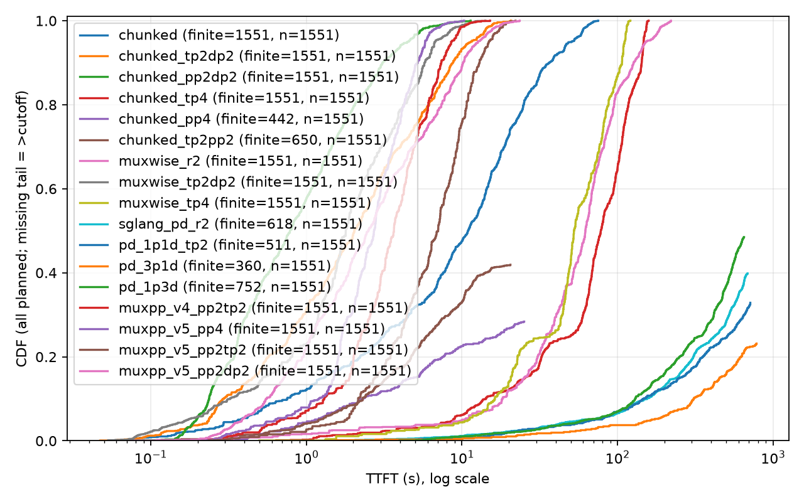
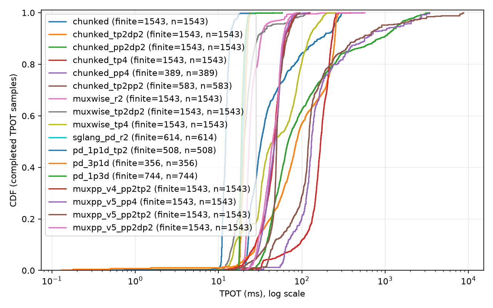
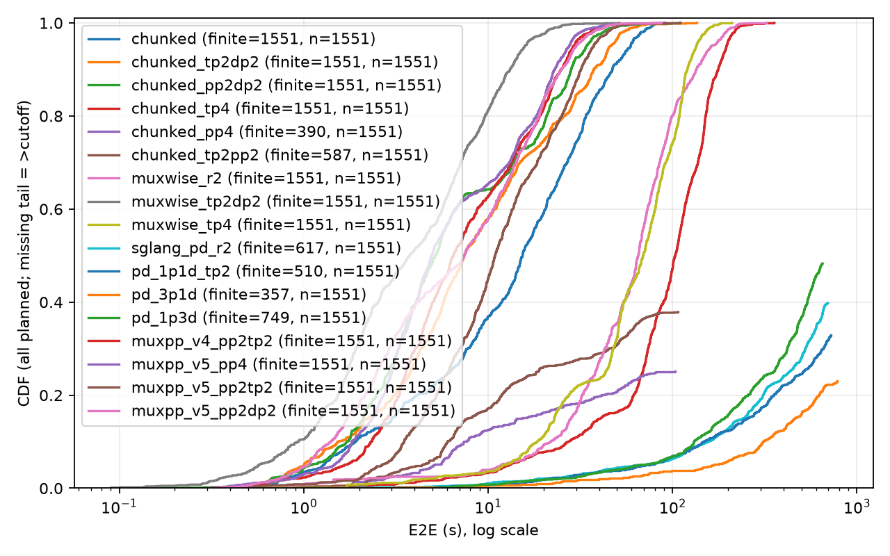
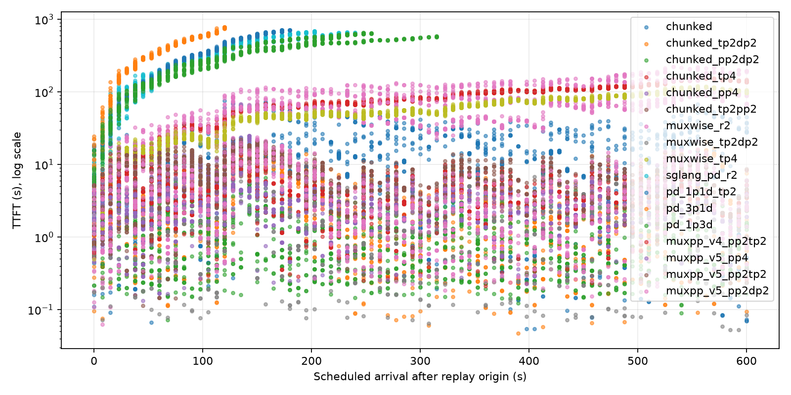
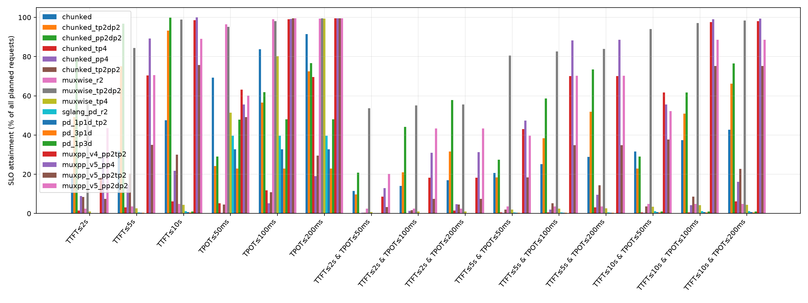

# Tool & Agent 8B完整矩阵

| 系统 | 配置 | label | 完成/未完/失败 | TTFT p50/p90/p99(s) | TPOT p50/p99(ms); n | E2E p50(s) | 输入/输出 tok/s | 主 SLO | TTFT≤2s | 10s/100ms SLO | cache命中率† | 每实例KV(token) |
| --- | --- | --- | --- | --- | --- | --- | --- | --- | --- | --- | --- | --- |
| Chunked | DP4 | chunked | 1551/0/0 | 10.955/36.315/64.830 | 32.510/295.272; n=1543 | 15.383 | 17190.798/400.167 | 25.210% | 18.956% | 37.331% | 40.538% | worker0(model)=43196; worker1(model)=43196; worker2(model)=43197; worker3(model)=43197 |
| Chunked | TP2DP2 | chunked_tp2dp2 | 1551/0/0 | 2.034/8.707/15.642 | 85.991/268.722; n=1543 | 7.399 | 18262.908/425.124 | 38.362% | 49.194% | 50.870% | 42.310% | worker0(model)=207118; worker1(model)=207062 |
| Chunked | PP2DP2 | chunked_pp2dp2 | 1551/0/0 | 0.783/3.082/7.249 | 68.767/2637.747; n=1543 | 5.173 | 18195.962/423.566 | 58.672% | 79.304% | 61.767% | 42.571% | worker0(model)=191374; worker1(model)=191318 |
| Chunked | TP4 | chunked_tp4 | 1551/0/0 | 78.107/142.957/153.921 | 168.653/255.508; n=1543 | 103.357 | 14794.458/344.385 | 0.580% | 1.547% | 0.580% | 42.158% | worker0(model)=536476 |
| Chunked | PP4 | chunked_pp4 | 390/0/1161 | >cutoff/>cutoff/>cutoff | 130.310/2722.797; n=389 | >cutoff | 5336.512/102.338 | 1.999% | 8.962% | 4.320% | 46.394% | worker0(model)=489244 |
| Chunked | TP2PP2 | chunked_tp2pp2 | 587/0/964 | >cutoff/>cutoff/>cutoff | 120.522/7902.192; n=583 | >cutoff | 7649.363/158.225 | 5.158% | 8.382% | 8.511% | 45.402% | worker0(model)=520522 |
| MuxWise | DP4 | muxwise_r2 | 1551/0/0 | 62.200/126.935/200.475 | 23.424/65.896; n=1543 | 65.269 | 13964.235/325.060 | 3.546% | 2.515% | 4.900% | 35.815% | worker0(model)=32421; worker1(model)=32421; worker2(model)=32421; worker3(model)=32421 |
| MuxWise | TP2DP2 | muxwise_tp2dp2 | 1551/0/0 | 1.791/5.749/10.063 | 20.212/104.941; n=1543 | 3.754 | 18320.739/426.470 | 82.656% | 55.899% | 97.034% | 43.143% | worker0(model)=161473; worker1(model)=161375 |
| MuxWise | TP4 | muxwise_tp4 | 1551/0/0 | 52.556/106.900/115.820 | 44.871/186.280; n=1543 | 69.348 | 15731.033/366.187 | 2.515% | 1.096% | 4.255% | 43.694% | worker0(model)=475809 |
| PD | 2P2D(TP1) | sglang_pd_r2 | 617/934/0 | >cutoff/>cutoff/>cutoff | 19.431/23.141; n=614 | >cutoff | 4895.631/118.145 | 0.516% | 0.129% | 1.161% | 0.000%† | worker0(prefill)=43197; worker1(prefill)=43196; worker2(decode)=43196; worker3(decode)=43197 |
| PD | 1P1D(TP2) | pd_1p1d_tp2 | 510/1041/0 | >cutoff/>cutoff/>cutoff | 12.106/17.233; n=508 | >cutoff | 4077.474/97.460 | 0.322% | 0.064% | 0.774% | 0.000%† | worker0(prefill)=207118; worker1(decode)=207062 |
| PD | 3P1D(TP1) | pd_3p1d | 357/1194/0 | >cutoff/>cutoff/>cutoff | 20.156/23.621; n=356 | >cutoff | 2874.445/65.178 | 0.387% | 0.193% | 0.580% | 0.000%† | worker0(prefill)=46986; worker1(prefill)=46986; worker2(prefill)=46986; worker3(decode)=46986 |
| PD | 1P3D(TP1) | pd_1p3d | 749/802/0 | >cutoff/>cutoff/>cutoff | 18.790/22.979; n=744 | >cutoff | 5891.856/136.803 | 0.064% | 0.000% | 1.032% | 0.000%† | worker0(prefill)=43196; worker1(decode)=43197; worker2(decode)=43197; worker3(decode)=43197 |
| MuxWise-PP | PP2×TP2 v4 | muxpp_v4_pp2tp2 | 1551/0/0 | 3.654/7.368/10.646 | 46.810/83.826; n=1543 | 6.495 | 18218.426/424.089 | 70.084% | 18.375% | 97.614% | 43.326% | worker0(model)=390622 |
| MuxWise-PP | PP4 v5 | muxpp_v5_pp4 | 1551/0/0 | 2.720/5.199/7.480 | 47.740/78.466; n=1543 | 4.944 | 18134.891/422.144 | 88.330% | 31.399% | 99.097% | 42.848% | worker0(model)=359498 |
| MuxWise-PP | PP2×TP2 v5 | muxpp_v5_pp2tp2 | 1551/0/0 | 7.025/12.939/18.361 | 50.038/86.339; n=1543 | 10.908 | 18215.933/424.031 | 34.881% | 7.479% | 75.242% | 43.285% | worker0(model)=390804 |
| MuxWise-PP | PP2DP2 v5 | muxpp_v5_pp2dp2 | 1551/0/0 | 2.507/10.182/17.644 | 44.584/75.777; n=1543 | 7.425 | 18139.358/422.248 | 70.277% | 43.456% | 88.652% | 37.490% | worker0(model)=126501; worker1(model)=126501 |

主SLO：TTFT≤5s且TPOT≤100ms。每配置一次测量，无置信区间。SLO/TTFT/E2E分母为全部1551条计划请求；TPOT仅取已完成且输出>1的样本。吞吐包含排空，输入包含缓存。KV为每实例逻辑容量，不乘TP/PP rank数。† PD cache仅为decode响应。

## 运行配置与GPU采样

| label | mem fraction | GPU均值% | 样本数 | 发送延迟p99/max(ms) | 正式日志 |
| --- | --- | --- | --- | --- | --- |
| chunked | {'worker0': 0.88, 'worker1': 0.88, 'worker2': 0.88, 'worker3': 0.88} | 93.306 | 516 | 16.208/27.869 | /root/workspace/muxpp_work/logs/p3/chunked/formal |
| chunked_tp2dp2 | {'worker0': 0.88, 'worker1': 0.88} | 96.118 | 484 | 16.734/33.903 | /root/workspace/muxpp_work/logs/p7a/chunked_tp2dp2/p7b-formal |
| chunked_pp2dp2 | {'worker0': 0.88, 'worker1': 0.88} | 79.727 | 484 | 24.463/26.462 | /root/workspace/muxpp_work/logs/p7a/chunked_pp2dp2/p7b-formal |
| chunked_tp4 | {'worker0': 0.88} | 95.923 | 600 | 29.122/30.694 | /root/workspace/muxpp_work/logs/p7a/chunked_tp4/p7b-formal |
| chunked_pp4 | {'worker0': 0.88} | 17.148 | 472 | 15.098/24.066 | /root/workspace/muxpp_work/logs/p7a/chunked_pp4/p7b-formal |
| chunked_tp2pp2 | {'worker0': 0.88} | 32.275 | 472 | 23.784/27.273 | /root/workspace/muxpp_work/logs/p7a/chunked_tp2pp2/p7b-formal |
| muxwise_r2 | {'worker0': 0.826, 'worker1': 0.826, 'worker2': 0.826, 'worker3': 0.826} | 89.584 | 628 | 29.793/51.195 | /root/workspace/muxpp_work/logs/p6/muxwise_r2-formal-adjust1 |
| muxwise_tp2dp2 | {'worker0': 0.76, 'worker1': 0.76} | 93.603 | 484 | 25.728/26.926 | /root/workspace/muxpp_work/logs/p7a/muxwise_tp2dp2/p7b-formal |
| muxwise_tp4 | {'worker0': 0.8} | 99.077 | 560 | 28.729/33.373 | /root/workspace/muxpp_work/logs/p7a/muxwise_tp4/p7b-formal |
| sglang_pd_r2 | {'worker0': 0.88, 'worker1': 0.88, 'worker2': 0.88, 'worker3': 0.88} | 50.637 | 708 | 18.638/20.303 | /root/workspace/muxpp_work/logs/p4a/sglang_pd_r2-formal |
| pd_1p1d_tp2 | {'worker0': 0.88, 'worker1': 0.88} | 47.644 | 708 | 16.858/35.921 | /root/workspace/muxpp_work/logs/p7a/pd_1p1d_tp2/p7b-formal |
| pd_3p1d | {'worker0': 0.9, 'worker1': 0.9, 'worker2': 0.9, 'worker3': 0.9} | 26.516 | 708 | 19.866/22.066 | /root/workspace/muxpp_work/logs/p7a/pd_3p1d/p7b-formal |
| pd_1p3d | {'worker0': 0.88, 'worker1': 0.88, 'worker2': 0.88, 'worker3': 0.88} | 62.818 | 708 | 20.142/27.857 | /root/workspace/muxpp_work/logs/p7a/pd_1p3d/p7b-formal |
| muxpp_v4_pp2tp2 | {'worker0': 0.71} | 92.119 | 488 | 24.266/31.761 | /root/workspace/muxpp_work/logs/p9b/muxpp_v4_pp2tp2 |
| muxpp_v5_pp4 | {'worker0': 0.71} | 95.932 | 488 | 10.711/21.262 | /root/workspace/muxpp_work/logs/p11b/muxpp_v5_pp4 |
| muxpp_v5_pp2tp2 | {'worker0': 0.71} | 94.349 | 484 | 18.897/26.165 | /root/workspace/muxpp_work/logs/p11b/muxpp_v5_pp2tp2 |
| muxpp_v5_pp2dp2 | {'worker0': 0.71, 'worker1': 0.71} | 92.064 | 488 | 22.908/35.406 | /root/workspace/muxpp_work/logs/p11b/muxpp_v5_pp2dp2 |

GPU每5秒采样，仅取客户端测量窗口（包括排空，不含长预热/冒烟）；GPU利用率包含通信等待，不能等同于有效计算效率。

## 完整延迟分位

| 系统 | 指标 | 样本数 | mean | p50 | p90 | p95 | p99 | max |
| --- | --- | --- | --- | --- | --- | --- | --- | --- |
| chunked | TTFT (s) | 1551 | 15.228 | 10.955 | 36.315 | 50.582 | 64.830 | 75.236 |
| chunked | TPOT (ms) | 1543 | 62.807 | 32.510 | 166.333 | 248.218 | 295.272 | 535.289 |
| chunked | E2E (s) | 1551 | 20.537 | 15.383 | 47.250 | 59.291 | 75.119 | 90.770 |
| chunked_tp2dp2 | TTFT (s) | 1551 | 3.449 | 2.034 | 8.707 | 11.374 | 15.642 | 20.693 |
| chunked_tp2dp2 | TPOT (ms) | 1543 | 120.287 | 85.991 | 249.279 | 256.118 | 268.722 | 279.470 |
| chunked_tp2dp2 | E2E (s) | 1551 | 14.187 | 7.399 | 37.433 | 45.865 | 60.698 | 136.017 |
| chunked_pp2dp2 | TTFT (s) | 1551 | 1.336 | 0.783 | 3.082 | 4.481 | 7.249 | 11.388 |
| chunked_pp2dp2 | TPOT (ms) | 1543 | 268.513 | 68.767 | 877.018 | 1422.908 | 2637.747 | 3419.675 |
| chunked_pp2dp2 | E2E (s) | 1551 | 10.964 | 5.173 | 28.179 | 34.132 | 48.122 | 111.026 |
| chunked_tp4 | TTFT (s) | 1551 | 79.263 | 78.107 | 142.957 | 147.329 | 153.921 | 158.780 |
| chunked_tp4 | TPOT (ms) | 1543 | 166.385 | 168.653 | 231.608 | 241.324 | 255.508 | 382.240 |
| chunked_tp4 | E2E (s) | 1551 | 104.771 | 103.357 | 176.654 | 196.211 | 225.563 | 356.951 |
| chunked_pp4 | TTFT (s) | 1551 | >cutoff | >cutoff | >cutoff | >cutoff | >cutoff | >cutoff |
| chunked_pp4 | TPOT (ms) | 389 | 299.588 | 130.310 | 564.580 | 1595.571 | 2722.797 | 3403.074 |
| chunked_pp4 | E2E (s) | 1551 | >cutoff | >cutoff | >cutoff | >cutoff | >cutoff | >cutoff |
| chunked_tp2pp2 | TTFT (s) | 1551 | >cutoff | >cutoff | >cutoff | >cutoff | >cutoff | >cutoff |
| chunked_tp2pp2 | TPOT (ms) | 583 | 338.626 | 120.522 | 490.574 | 912.911 | 7902.192 | 8776.848 |
| chunked_tp2pp2 | E2E (s) | 1551 | >cutoff | >cutoff | >cutoff | >cutoff | >cutoff | >cutoff |
| muxwise_r2 | TTFT (s) | 1551 | 67.341 | 62.200 | 126.935 | 151.810 | 200.475 | 220.920 |
| muxwise_r2 | TPOT (ms) | 1543 | 26.940 | 23.424 | 32.212 | 36.775 | 65.896 | 573.738 |
| muxwise_r2 | E2E (s) | 1551 | 71.381 | 65.269 | 134.414 | 162.265 | 210.125 | 325.118 |
| muxwise_tp2dp2 | TTFT (s) | 1551 | 2.568 | 1.791 | 5.749 | 6.697 | 10.063 | 14.153 |
| muxwise_tp2dp2 | TPOT (ms) | 1543 | 23.752 | 20.212 | 29.343 | 42.865 | 104.941 | 124.928 |
| muxwise_tp2dp2 | E2E (s) | 1551 | 5.693 | 3.754 | 13.144 | 15.765 | 22.915 | 51.619 |
| muxwise_tp4 | TTFT (s) | 1551 | 57.904 | 52.556 | 106.900 | 111.100 | 115.820 | 121.090 |
| muxwise_tp4 | TPOT (ms) | 1543 | 63.462 | 44.871 | 122.997 | 150.338 | 186.280 | 251.135 |
| muxwise_tp4 | E2E (s) | 1551 | 70.140 | 69.348 | 120.414 | 134.308 | 159.766 | 210.653 |
| sglang_pd_r2 | TTFT (s) | 1551 | >cutoff | >cutoff | >cutoff | >cutoff | >cutoff | >cutoff |
| sglang_pd_r2 | TPOT (ms) | 614 | 19.616 | 19.431 | 21.513 | 22.063 | 23.141 | 45.251 |
| sglang_pd_r2 | E2E (s) | 1551 | >cutoff | >cutoff | >cutoff | >cutoff | >cutoff | >cutoff |
| pd_1p1d_tp2 | TTFT (s) | 1551 | >cutoff | >cutoff | >cutoff | >cutoff | >cutoff | >cutoff |
| pd_1p1d_tp2 | TPOT (ms) | 508 | 12.250 | 12.106 | 13.664 | 14.650 | 17.233 | 23.905 |
| pd_1p1d_tp2 | E2E (s) | 1551 | >cutoff | >cutoff | >cutoff | >cutoff | >cutoff | >cutoff |
| pd_3p1d | TTFT (s) | 1551 | >cutoff | >cutoff | >cutoff | >cutoff | >cutoff | >cutoff |
| pd_3p1d | TPOT (ms) | 356 | 19.974 | 20.156 | 22.228 | 22.788 | 23.621 | 23.975 |
| pd_3p1d | E2E (s) | 1551 | >cutoff | >cutoff | >cutoff | >cutoff | >cutoff | >cutoff |
| pd_1p3d | TTFT (s) | 1551 | >cutoff | >cutoff | >cutoff | >cutoff | >cutoff | >cutoff |
| pd_1p3d | TPOT (ms) | 744 | 19.179 | 18.790 | 20.979 | 21.840 | 22.979 | 58.293 |
| pd_1p3d | E2E (s) | 1551 | >cutoff | >cutoff | >cutoff | >cutoff | >cutoff | >cutoff |
| muxpp_v4_pp2tp2 | TTFT (s) | 1551 | 4.068 | 3.654 | 7.368 | 8.518 | 10.646 | 15.185 |
| muxpp_v4_pp2tp2 | TPOT (ms) | 1543 | 46.730 | 46.810 | 62.869 | 72.246 | 83.826 | 123.459 |
| muxpp_v4_pp2tp2 | E2E (s) | 1551 | 10.623 | 6.495 | 24.794 | 29.008 | 39.955 | 91.436 |
| muxpp_v5_pp4 | TTFT (s) | 1551 | 2.937 | 2.720 | 5.199 | 5.795 | 7.480 | 10.335 |
| muxpp_v5_pp4 | TPOT (ms) | 1543 | 47.185 | 47.740 | 61.421 | 69.016 | 78.466 | 121.369 |
| muxpp_v5_pp4 | E2E (s) | 1551 | 9.552 | 4.944 | 23.005 | 27.457 | 37.166 | 90.671 |
| muxpp_v5_pp2tp2 | TTFT (s) | 1551 | 7.282 | 7.025 | 12.939 | 14.897 | 18.361 | 22.108 |
| muxpp_v5_pp2tp2 | TPOT (ms) | 1543 | 51.004 | 50.038 | 66.101 | 74.469 | 86.339 | 94.703 |
| muxpp_v5_pp2tp2 | E2E (s) | 1551 | 14.871 | 10.908 | 31.903 | 37.336 | 48.500 | 109.882 |
| muxpp_v5_pp2dp2 | TTFT (s) | 1551 | 4.129 | 2.507 | 10.182 | 12.644 | 17.644 | 23.534 |
| muxpp_v5_pp2dp2 | TPOT (ms) | 1543 | 45.242 | 44.584 | 59.761 | 64.812 | 75.777 | 86.916 |
| muxpp_v5_pp2dp2 | E2E (s) | 1551 | 10.622 | 7.425 | 24.923 | 29.969 | 42.435 | 87.231 |

## 全部 SLO 阈值

| 系统 | ttft_le_2s | ttft_le_5s | ttft_le_10s | tpot_le_50ms | tpot_le_100ms | tpot_le_200ms | ttft_le_2s_and_tpot_le_50ms | ttft_le_2s_and_tpot_le_100ms | ttft_le_2s_and_tpot_le_200ms | ttft_le_5s_and_tpot_le_50ms | ttft_le_5s_and_tpot_le_100ms | ttft_le_5s_and_tpot_le_200ms | ttft_le_10s_and_tpot_le_50ms | ttft_le_10s_and_tpot_le_100ms | ttft_le_10s_and_tpot_le_200ms |
| --- | --- | --- | --- | --- | --- | --- | --- | --- | --- | --- | --- | --- | --- | --- | --- |
| chunked | 18.956% | 31.915% | 47.518% | 69.310% | 83.752% | 91.554% | 11.412% | 14.055% | 17.021% | 20.696% | 25.210% | 28.885% | 31.593% | 37.331% | 42.682% |
| chunked_tp2dp2 | 49.194% | 75.113% | 93.295% | 24.242% | 56.609% | 72.469% | 9.671% | 21.019% | 31.528% | 18.440% | 38.362% | 51.902% | 22.888% | 50.870% | 66.280% |
| chunked_pp2dp2 | 79.304% | 96.712% | 99.871% | 28.949% | 61.896% | 76.660% | 20.825% | 44.165% | 57.769% | 27.466% | 58.672% | 73.436% | 28.949% | 61.767% | 76.531% |
| chunked_tp4 | 1.547% | 3.095% | 6.190% | 5.222% | 11.734% | 69.632% | 0.193% | 0.193% | 1.547% | 0.580% | 0.580% | 3.095% | 0.580% | 0.580% | 6.125% |
| chunked_pp4 | 8.962% | 14.829% | 21.728% | 0.322% | 5.222% | 19.020% | 0.322% | 1.354% | 4.771% | 0.322% | 1.999% | 9.607% | 0.322% | 4.320% | 16.119% |
| chunked_tp2pp2 | 8.382% | 20.374% | 30.045% | 4.578% | 10.832% | 29.465% | 0.451% | 1.676% | 4.578% | 1.999% | 5.158% | 14.313% | 3.611% | 8.511% | 22.824% |
| muxwise_r2 | 2.515% | 3.546% | 4.900% | 96.454% | 99.033% | 99.355% | 2.515% | 2.515% | 2.515% | 3.546% | 3.546% | 3.546% | 4.900% | 4.900% | 4.900% |
| muxwise_tp2dp2 | 55.899% | 84.397% | 98.904% | 95.164% | 98.130% | 99.484% | 53.643% | 55.126% | 55.577% | 80.593% | 82.656% | 83.946% | 94.068% | 97.034% | 98.388% |
| muxwise_tp4 | 1.096% | 2.643% | 4.384% | 51.386% | 80.142% | 99.291% | 0.645% | 1.096% | 1.096% | 2.063% | 2.515% | 2.643% | 3.482% | 4.255% | 4.384% |
| sglang_pd_r2 | 0.129% | 0.516% | 1.161% | 39.587% | 39.587% | 39.587% | 0.129% | 0.129% | 0.129% | 0.516% | 0.516% | 0.516% | 1.161% | 1.161% | 1.161% |
| pd_1p1d_tp2 | 0.064% | 0.322% | 0.774% | 32.753% | 32.753% | 32.753% | 0.064% | 0.064% | 0.064% | 0.322% | 0.322% | 0.322% | 0.774% | 0.774% | 0.774% |
| pd_3p1d | 0.193% | 0.387% | 0.580% | 22.953% | 22.953% | 22.953% | 0.193% | 0.193% | 0.193% | 0.387% | 0.387% | 0.387% | 0.580% | 0.580% | 0.580% |
| pd_1p3d | 0.000% | 0.064% | 1.032% | 47.905% | 47.969% | 47.969% | 0.000% | 0.000% | 0.000% | 0.064% | 0.064% | 0.064% | 1.032% | 1.032% | 1.032% |
| muxpp_v4_pp2tp2 | 18.375% | 70.471% | 98.517% | 63.121% | 99.097% | 99.484% | 8.575% | 18.311% | 18.311% | 43.069% | 70.084% | 70.084% | 61.702% | 97.614% | 98.001% |
| muxpp_v5_pp4 | 31.399% | 89.168% | 99.936% | 55.577% | 99.162% | 99.484% | 12.895% | 30.883% | 31.206% | 47.324% | 88.330% | 88.652% | 55.513% | 99.097% | 99.420% |
| muxpp_v5_pp2tp2 | 7.479% | 35.010% | 75.693% | 49.130% | 99.484% | 99.484% | 3.353% | 7.479% | 7.479% | 18.375% | 34.881% | 34.881% | 37.718% | 75.242% | 75.242% |
| muxpp_v5_pp2dp2 | 43.456% | 70.535% | 89.104% | 60.026% | 99.484% | 99.484% | 20.116% | 43.327% | 43.327% | 39.716% | 70.277% | 70.277% | 52.224% | 88.652% | 88.652% |

TTFT/E2E 分位以全部计划请求为样本；缺少首token/未成功完成的值取+∞，显示为 >cutoff。TPOT 仅采用截止前成功完成且输出>1的请求，上表列出样本数。SLO 分母为全部计划请求，unfinished/failed/未发均不达标。吞吐计入截止前交付的全部输出（含部分输出）；输入只计截止前已收到首token的请求。分母为min(实际时长,截止时刻)。

ITL 是两个增加 completion_tokens 的 SSE 事件之间的观测间隔；合包时无法还原真实逐 token ITL。缓存使用成功响应的输入token加权比例；字段缺失显示为 —。PD decode响应的缓存字段不代表prefill实际命中。CSV 保留完整指标（延迟单位为秒，比例范围 0–1）。每版本仅一次正式测量，无置信区间。

## 运行条件

| 系统 | time-scale | 请求数 | 预热 | 中断 | trace |
| --- | --- | --- | --- | --- | --- |
| chunked | 1.0 | 1551 | 2 | False | /root/workspace/muxpp_work/bench/toolagent_600_240_x2.5.jsonl |
| chunked_tp2dp2 | 1.0 | 1551 | 2 | False | /root/workspace/muxpp_work/bench/toolagent_600_240_x2.5.jsonl |
| chunked_pp2dp2 | 1.0 | 1551 | 2 | False | /root/workspace/muxpp_work/bench/toolagent_600_240_x2.5.jsonl |
| chunked_tp4 | 1.0 | 1551 | 2 | False | /root/workspace/muxpp_work/bench/toolagent_600_240_x2.5.jsonl |
| chunked_pp4 | 1.0 | 1551 | 2 | False | /root/workspace/muxpp_work/bench/toolagent_600_240_x2.5.jsonl |
| chunked_tp2pp2 | 1.0 | 1551 | 2 | False | /root/workspace/muxpp_work/bench/toolagent_600_240_x2.5.jsonl |
| muxwise_r2 | 1.0 | 1551 | 2 | False | /root/workspace/muxpp_work/bench/toolagent_600_240_x2.5.jsonl |
| muxwise_tp2dp2 | 1.0 | 1551 | 2 | False | /root/workspace/muxpp_work/bench/toolagent_600_240_x2.5.jsonl |
| muxwise_tp4 | 1.0 | 1551 | 2 | False | /root/workspace/muxpp_work/bench/toolagent_600_240_x2.5.jsonl |
| sglang_pd_r2 | 1.0 | 1551 | 2 | False | /root/workspace/muxpp_work/bench/toolagent_600_240_x2.5.jsonl |
| pd_1p1d_tp2 | 1.0 | 1551 | 2 | False | /root/workspace/muxpp_work/bench/toolagent_600_240_x2.5.jsonl |
| pd_3p1d | 1.0 | 1551 | 2 | False | /root/workspace/muxpp_work/bench/toolagent_600_240_x2.5.jsonl |
| pd_1p3d | 1.0 | 1551 | 2 | False | /root/workspace/muxpp_work/bench/toolagent_600_240_x2.5.jsonl |
| muxpp_v4_pp2tp2 | 1.0 | 1551 | 2 | False | /root/workspace/muxpp_work/bench/toolagent_600_240_x2.5.jsonl |
| muxpp_v5_pp4 | 1.0 | 1551 | 2 | False | /root/workspace/muxpp_work/bench/toolagent_600_240_x2.5.jsonl |
| muxpp_v5_pp2tp2 | 1.0 | 1551 | 2 | False | /root/workspace/muxpp_work/bench/toolagent_600_240_x2.5.jsonl |
| muxpp_v5_pp2dp2 | 1.0 | 1551 | 2 | False | /root/workspace/muxpp_work/bench/toolagent_600_240_x2.5.jsonl |

比较要求相同 trace、time-scale 和请求数量；不同版本/系统的源码、后端、KV容量和配置差异必须结合主报告解释。

