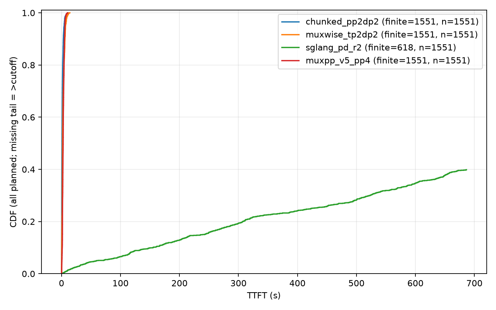
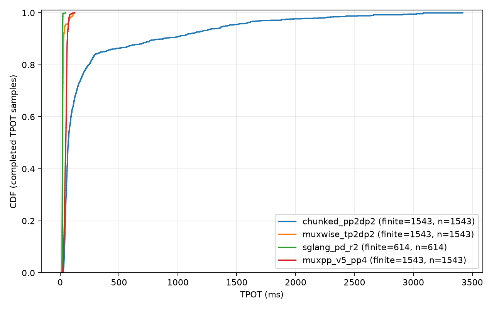
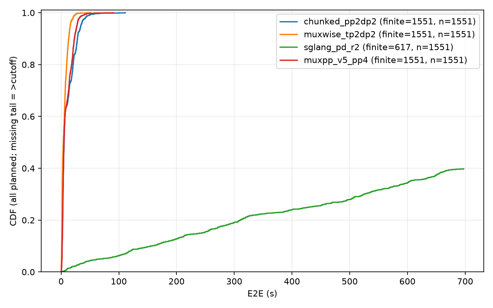
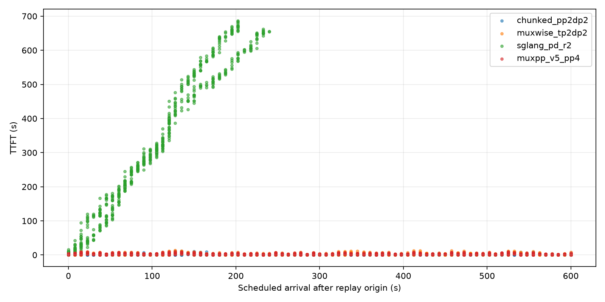
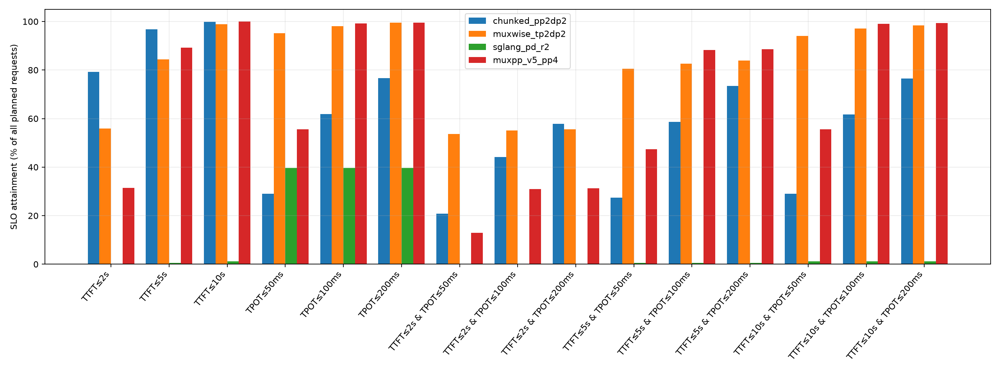

# Tool&Agent 各系统最佳配置

| 系统 | 配置 | label | 完成/未完/失败 | TTFT p50/p90/p99(s) | TPOT p50/p99(ms); n | E2E p50(s) | 输入/输出 tok/s | 主 SLO | TTFT≤2s | 10s/100ms SLO | cache命中率† | 每实例KV(token) |
| --- | --- | --- | --- | --- | --- | --- | --- | --- | --- | --- | --- | --- |
| Chunked | PP2DP2 | chunked_pp2dp2 | 1551/0/0 | 0.783/3.082/7.249 | 68.767/2637.747; n=1543 | 5.173 | 18195.962/423.566 | 58.672% | 79.304% | 61.767% | 42.571% | worker0(model)=191374; worker1(model)=191318 |
| MuxWise | TP2DP2 | muxwise_tp2dp2 | 1551/0/0 | 1.791/5.749/10.063 | 20.212/104.941; n=1543 | 3.754 | 18320.739/426.470 | 82.656% | 55.899% | 97.034% | 43.143% | worker0(model)=161473; worker1(model)=161375 |
| PD | 2P2D(TP1) | sglang_pd_r2 | 617/934/0 | >cutoff/>cutoff/>cutoff | 19.431/23.141; n=614 | >cutoff | 4895.631/118.145 | 0.516% | 0.129% | 1.161% | 0.000%† | worker0(prefill)=43197; worker1(prefill)=43196; worker2(decode)=43196; worker3(decode)=43197 |
| MuxWise-PP | PP4 v5 | muxpp_v5_pp4 | 1551/0/0 | 2.720/5.199/7.480 | 47.740/78.466; n=1543 | 4.944 | 18134.891/422.144 | 88.330% | 31.399% | 99.097% | 42.848% | worker0(model)=359498 |

主SLO：TTFT≤5s且TPOT≤100ms。每配置一次测量，无置信区间。SLO/TTFT/E2E分母为全部1551条计划请求；TPOT仅取已完成且输出>1的样本。吞吐包含排空，输入包含缓存。KV为每实例逻辑容量，不乘TP/PP rank数。† PD cache仅为decode响应。

## 运行配置与GPU采样

| label | mem fraction | GPU均值% | 样本数 | 发送延迟p99/max(ms) | 正式日志 |
| --- | --- | --- | --- | --- | --- |
| chunked_pp2dp2 | {'worker0': 0.88, 'worker1': 0.88} | 79.727 | 484 | 24.463/26.462 | /root/workspace/muxpp_work/logs/p7a/chunked_pp2dp2/p7b-formal |
| muxwise_tp2dp2 | {'worker0': 0.76, 'worker1': 0.76} | 93.603 | 484 | 25.728/26.926 | /root/workspace/muxpp_work/logs/p7a/muxwise_tp2dp2/p7b-formal |
| sglang_pd_r2 | {'worker0': 0.88, 'worker1': 0.88, 'worker2': 0.88, 'worker3': 0.88} | 50.637 | 708 | 18.638/20.303 | /root/workspace/muxpp_work/logs/p4a/sglang_pd_r2-formal |
| muxpp_v5_pp4 | {'worker0': 0.71} | 95.932 | 488 | 10.711/21.262 | /root/workspace/muxpp_work/logs/p11b/muxpp_v5_pp4 |

GPU每5秒采样，仅取客户端测量窗口（包括排空，不含长预热/冒烟）；GPU利用率包含通信等待，不能等同于有效计算效率。

## 完整延迟分位

| 系统 | 指标 | 样本数 | mean | p50 | p90 | p95 | p99 | max |
| --- | --- | --- | --- | --- | --- | --- | --- | --- |
| chunked_pp2dp2 | TTFT (s) | 1551 | 1.336 | 0.783 | 3.082 | 4.481 | 7.249 | 11.388 |
| chunked_pp2dp2 | TPOT (ms) | 1543 | 268.513 | 68.767 | 877.018 | 1422.908 | 2637.747 | 3419.675 |
| chunked_pp2dp2 | E2E (s) | 1551 | 10.964 | 5.173 | 28.179 | 34.132 | 48.122 | 111.026 |
| muxwise_tp2dp2 | TTFT (s) | 1551 | 2.568 | 1.791 | 5.749 | 6.697 | 10.063 | 14.153 |
| muxwise_tp2dp2 | TPOT (ms) | 1543 | 23.752 | 20.212 | 29.343 | 42.865 | 104.941 | 124.928 |
| muxwise_tp2dp2 | E2E (s) | 1551 | 5.693 | 3.754 | 13.144 | 15.765 | 22.915 | 51.619 |
| sglang_pd_r2 | TTFT (s) | 1551 | >cutoff | >cutoff | >cutoff | >cutoff | >cutoff | >cutoff |
| sglang_pd_r2 | TPOT (ms) | 614 | 19.616 | 19.431 | 21.513 | 22.063 | 23.141 | 45.251 |
| sglang_pd_r2 | E2E (s) | 1551 | >cutoff | >cutoff | >cutoff | >cutoff | >cutoff | >cutoff |
| muxpp_v5_pp4 | TTFT (s) | 1551 | 2.937 | 2.720 | 5.199 | 5.795 | 7.480 | 10.335 |
| muxpp_v5_pp4 | TPOT (ms) | 1543 | 47.185 | 47.740 | 61.421 | 69.016 | 78.466 | 121.369 |
| muxpp_v5_pp4 | E2E (s) | 1551 | 9.552 | 4.944 | 23.005 | 27.457 | 37.166 | 90.671 |

## 全部 SLO 阈值

| 系统 | ttft_le_2s | ttft_le_5s | ttft_le_10s | tpot_le_50ms | tpot_le_100ms | tpot_le_200ms | ttft_le_2s_and_tpot_le_50ms | ttft_le_2s_and_tpot_le_100ms | ttft_le_2s_and_tpot_le_200ms | ttft_le_5s_and_tpot_le_50ms | ttft_le_5s_and_tpot_le_100ms | ttft_le_5s_and_tpot_le_200ms | ttft_le_10s_and_tpot_le_50ms | ttft_le_10s_and_tpot_le_100ms | ttft_le_10s_and_tpot_le_200ms |
| --- | --- | --- | --- | --- | --- | --- | --- | --- | --- | --- | --- | --- | --- | --- | --- |
| chunked_pp2dp2 | 79.304% | 96.712% | 99.871% | 28.949% | 61.896% | 76.660% | 20.825% | 44.165% | 57.769% | 27.466% | 58.672% | 73.436% | 28.949% | 61.767% | 76.531% |
| muxwise_tp2dp2 | 55.899% | 84.397% | 98.904% | 95.164% | 98.130% | 99.484% | 53.643% | 55.126% | 55.577% | 80.593% | 82.656% | 83.946% | 94.068% | 97.034% | 98.388% |
| sglang_pd_r2 | 0.129% | 0.516% | 1.161% | 39.587% | 39.587% | 39.587% | 0.129% | 0.129% | 0.129% | 0.516% | 0.516% | 0.516% | 1.161% | 1.161% | 1.161% |
| muxpp_v5_pp4 | 31.399% | 89.168% | 99.936% | 55.577% | 99.162% | 99.484% | 12.895% | 30.883% | 31.206% | 47.324% | 88.330% | 88.652% | 55.513% | 99.097% | 99.420% |

TTFT/E2E 分位以全部计划请求为样本；缺少首token/未成功完成的值取+∞，显示为 >cutoff。TPOT 仅采用截止前成功完成且输出>1的请求，上表列出样本数。SLO 分母为全部计划请求，unfinished/failed/未发均不达标。吞吐计入截止前交付的全部输出（含部分输出）；输入只计截止前已收到首token的请求。分母为min(实际时长,截止时刻)。

ITL 是两个增加 completion_tokens 的 SSE 事件之间的观测间隔；合包时无法还原真实逐 token ITL。缓存使用成功响应的输入token加权比例；字段缺失显示为 —。PD decode响应的缓存字段不代表prefill实际命中。CSV 保留完整指标（延迟单位为秒，比例范围 0–1）。每版本仅一次正式测量，无置信区间。

## 运行条件

| 系统 | time-scale | 请求数 | 预热 | 中断 | trace |
| --- | --- | --- | --- | --- | --- |
| chunked_pp2dp2 | 1.0 | 1551 | 2 | False | /root/workspace/muxpp_work/bench/toolagent_600_240_x2.5.jsonl |
| muxwise_tp2dp2 | 1.0 | 1551 | 2 | False | /root/workspace/muxpp_work/bench/toolagent_600_240_x2.5.jsonl |
| sglang_pd_r2 | 1.0 | 1551 | 2 | False | /root/workspace/muxpp_work/bench/toolagent_600_240_x2.5.jsonl |
| muxpp_v5_pp4 | 1.0 | 1551 | 2 | False | /root/workspace/muxpp_work/bench/toolagent_600_240_x2.5.jsonl |

比较要求相同 trace、time-scale 和请求数量；不同版本/系统的源码、后端、KV容量和配置差异必须结合主报告解释。

